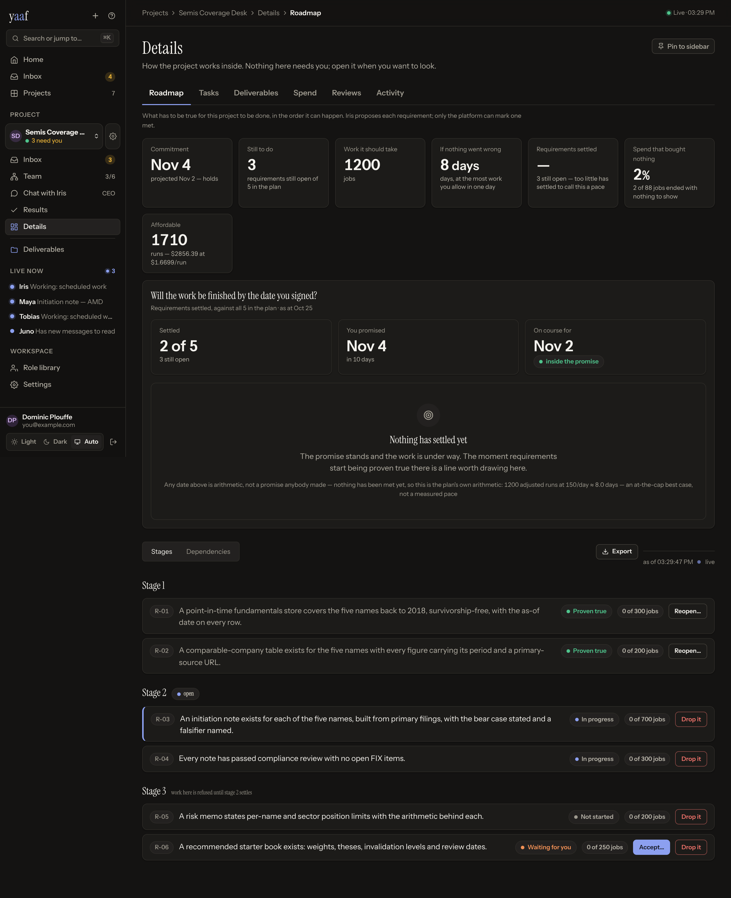
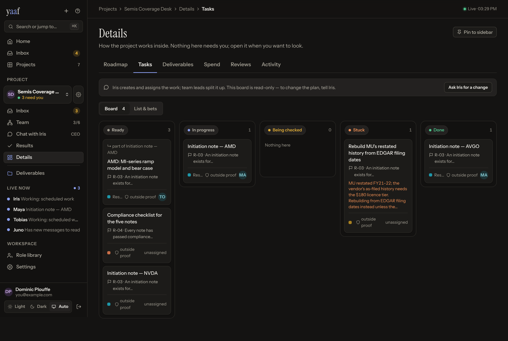
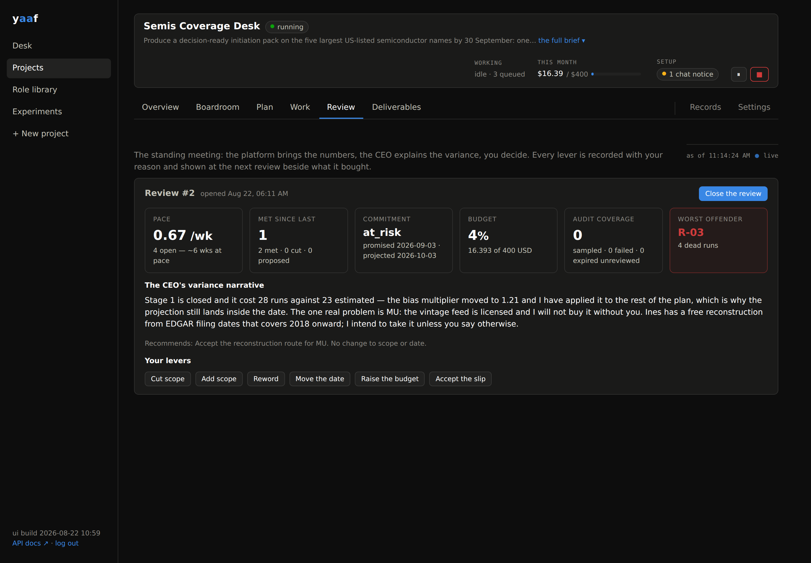

# yaaf — Yet Another Agent Framework

**Run a small AI company on your own hardware — with rules the agents can't
talk their way out of, and a delivery date they can't quietly break.**

A **CEO** agent plans and prioritizes, teams of **role-based agents** do the
work, and **you are the chairman** — the one human, with a few real powers.
Agents wake on a schedule or when something needs them, do one unit of work,
and sleep. Docker Compose on your own box; a web dashboard to steer from.


## The problem

Leave an agent running for an afternoon and you meet the failure modes. It
marks its own work "done". It invents busywork and calls it progress. It loops
with another agent at full API price, spends your budget while you sleep,
leaves a record you can't reconstruct — and can't tell you **when it will be
finished**.

The usual fix is better prompts. But a prompt is a *suggestion*, and a
sufficiently clever model talks itself around one.

**yaaf's core idea: the rules live in the server, not the prompt.** Agents act
only through an authenticated API on short-lived per-run tokens, and every rule
is a refusal or an automatic state change. An agent can't be talked out of
rules it never held. Break one and it doesn't get a stern reminder — it gets a
403.

## Isn't this just a Claude Skill?

**yaaf runs your skills** — a role's `tool_permissions.skills` is an allowlist
handed to the Agent SDK. A skill is a *capability*. yaaf is the *company* that
decides which capability to point at what, checks it got done, pays for it from
a capped budget, and keeps the receipt.

**Don't use yaaf when a skill will do**: you're watching, it finishes in one
sitting, nothing irreversible happens, nobody asks in six weeks how you know.
**Reach for yaaf when** it must run unattended for weeks, "done" can't be
self-graded, money has to stop by itself, you'll have to reconstruct it later
for a client or an auditor — or you want agents to disagree, because one agent
checking its own work has the same blind spots in both seats.

| | Skill / Code session | Cron'd prompt | Agent library | **yaaf** |
|---|---|---|---|---|
| **What it is** | A capability you invoke | The same, on a timer | A toolkit for your app | A platform you deploy and chair |
| **What's next** | You decide | You decided, in advance | Your code decides | A CEO agent, from a plan you accepted |
| **"Complete"** | The model says so | The model says so | The model says so | The **platform** runs the test, or you spot-audit |
| **Budget** | You watch the meter | You watch the meter | You watch the meter | Metered per run; warns, then **pauses the project** |
| **Lifespan** | One session | One run | While your script runs | Weeks — wakes, cycles, webhooks |
| **Memory** | Your own files | What you pass in | Yours to build | Scoped, capped, curated |
| **Crash mid-action** | You notice, redo it | You notice, redo it | Yours to build | Lease reaped; ledger stops the double-fire |
| **The record** | Your scrollback | Your logs | Your logs | Every message, run, dollar, decision, refusal |
| **Many agents** | — | — | Yes, as you code it | Teams with charters that conflict on purpose |

None of that is capability — a good model with a good skill out-writes yaaf's
agents on any single task. **The difference is governance and duration.** Note
the "yours to build" cells: a library gets you there, but the work is a queue,
a policy layer, a verifier, a ledger, an audit trail and a UI. Worth building
if it's your product; yaaf is it already built when it isn't.

## Work that has a terminus

A task list is a pipeline with no end. So outside open-ended mode the root
object is the **requirement**: a thing that must be *true* at the end, carrying
a test the platform runs itself.

- **The CEO proposes; you accept.** The forecast's denominator stays out of the
  hands of the party it grades.
- **Nothing but the platform writes "met".** The strongest form of "never
  self-graded" is that the agent-side verb doesn't exist.
- **A task serving no requirement is refused.** Work that makes nothing true is
  how a company stays busy without finishing.
- **Estimates are scored, not trusted.** Estimate is weighed against actual
  cost; the next plan is read at that ratio. Small numbers buy one round.



## A delivery date the company can't quietly break

The CEO proposes a date; it never **writes** one. The platform stamps it from
its own projection of measured pace, and re-projects every tick. When the
projection lands past the promise, the commitment moves itself to *at risk*,
**new scope freezes**, and two honest ways out remain: cut something, or reset
the date — with a reason, and only to what the arithmetic now says. Who pulls
those levers is the autonomy setting; that they're the only two is not.

The guarantee isn't that the date holds. It's that when it stops holding, the
company can't quietly add work and hope.

## What that looks like in practice

- **Money can't run away.** Every run is metered, killed ones included. 80%
  warns the CEO; 100% pauses the project and emails you. Real-world spend has
  its own envelope. Circuit breakers kill message loops and refusal storms.
- **"Done" means verified.** `command` tests run in a sandbox, by the
  *platform*, not the agent that wants them to pass. Real-world claims count
  once the platform fetches, checks and snapshots them — or once they arrive by
  signed webhook, which agents can't forge.
- **Agents are contained, not trusted.** Fresh container per run, with the open
  internet: capability shouldn't be a firewall ticket. Secrets are encrypted,
  role-scoped, injected per run, never shown in chat. Captchas go to a human.
- **Everything is on the record.** Every message, transition, run, dollar and
  enforcement, in Postgres and on screen — plus random samples of "completed"
  work dealt to you to spot-check, because AI reviewers approve nearly
  everything and you don't.
- **The rules are yours.** Each project runs under a rulebook agents can't edit
  or argue with. Change it whenever: it binds from the next agent call, keeps
  the reason you gave, and is disclosed to the CEO.



## How much you do is a setting

Two presets, each nothing but five constitution switches. **Supervised**: you
accept scope, sign the date, judge unverifiable closes. **Autonomous**: the CEO
does all three and tells you after. Unchanged at either end — the platform
still verifies what it can, refuses to quietly trust what it can't, caps every
dollar, and hands security challenges to you. → **[AUTONOMY](docs/AUTONOMY.md)**

## Three shapes of company

Chosen once at creation, because the rules differ by shape.

| | What it is | Example goal |
|---|---|---|
| **Explore** | Chase a goal with no fixed end. Bets, proof, and your call on when it earned its keep. | "Find one defensible idea in 30 days." |
| **Deliver** | Ship one thing, then stop. You accept what done means; the platform proves it. | "An initiation pack on five names." |
| **Operate** | A Deliver that restarts on a rhythm, and gets better each cycle. | "A brief before the open, every trading day." |

An Operate cycle roll carries unfinished scope forward, reopens the plan gate,
and hands the CEO the last three cycles' narratives verbatim — "learn from last
time" enforced by the platform, not asked for in a prompt.

## The standing meeting

Weekly by default, the janitor opens a **review** — zero tokens, whatever the
budget, even on an empty board, because that's the review you most need. It
carries the platform's frozen numbers; the CEO files its variance narrative.
Then you pull levers: cut scope, add scope, reword, move the date, raise the
budget, accept the slip. Each is recorded with your reason and shown at the
*next* review beside what it bought.



## The rest of the map

Money, verification, containment and the audit trail are above. The rest —
full reference in **[docs/FEATURES.md](docs/FEATURES.md)**:

| Area | What you get |
|---|---|
| **The org** | Versioned role library, teams with leads, CEO-only planning, solo mode. A role edit never silently changes a running company — you repin. |
| **The plan** | Ordered stages, a dependency graph with a critical path, a plan gate that checks the arithmetic. |
| **Loop brakes** | Wake and run ceilings, a circuit breaker for ping-pong threads, refusal caps, suppressed idle wakes, an idempotency ledger. |
| **Memory** | Project and team scopes with a curator; caps refuse rather than silently evict. |
| **Money** | USD or token budgets, a separate real-world spend envelope, idempotent purchases, revenue only by signed webhook. |
| **Sandbox & proof** | Chromium in the box, an assist protocol for human-only steps, a CEO-judgment metric on close quality. |
| **Chat** | A resident CEO session: Boardroom and Slack answer in seconds, without consuming the work queue's caps. |
| **Integrations** | Slack (Socket Mode — no public URL), GitHub repo-per-project, MCP data sources, signed webhooks, S3 artifacts, email alerts. → [INTEGRATIONS](docs/INTEGRATIONS.md) |
| **Proof it works** | 524 offline tests, chaos tests, golden-transcript evals that gate prompt edits, a $0 scripted CI run of a whole company. |

## What you give up

- **You deploy and run a thing.** Postgres, two containers, a box. A skill is a file.
- **Setup is minutes, not seconds.** A goal worth planning from takes longer to
  write than a prompt, on purpose.
- **You accept a plan.** On the default dial, scope waits for you — the whole
  mechanism for keeping the forecast honest. (One switch hands it over.)
- **The floor is higher than the ceiling is high.** Planning, review and
  verification cost tokens. On a one-sitting task that buys you nothing.
- **It is pre-1.0.** APIs move.

If you read that and thought "none of this is my problem", believe yourself.
Use a skill.

## The honest part

Nobody has shown a CEO + team beats one good agent on the same budget and
rules, and yaaf doesn't claim to have. It gives you a fair way to find out:
**solo mode** runs a single agent under byte-identical governance, so the same
goal can go to a hierarchy and to one brain and the bills compared. If the org
layer isn't worth it, the governance layer underneath stands on its own.

## Quickstart

One script takes a bare box to a running company with real, sandboxed agents:

```bash
curl -fsSL https://get.docker.com | sh          # if docker isn't there yet
sudo usermod -aG docker "$USER"                 # then log out and back in

git clone <your-yaaf-remote> yaaf && cd yaaf
./deploy_single_server.sh
```

Secrets, images, Postgres + API + runner, migrations, the role library, and
your login token printed at the end. Safe to re-run. The dashboard binds to
`127.0.0.1`, so reach it over SSH:

```bash
ssh -N -L 8080:localhost:8080 you@your-server   # then open localhost:8080/app
```

`--bind 0.0.0.0` publishes it instead — but the admin token is a static bearer,
so put TLS in front of it first. Afterwards:

```bash
./update_single_server.sh    # pull new code, back up, rebuild, migrate, verify
./kill_single_server.sh      # stop everything, keep the data (--wipe destroys it)
```

Migrations apply at container start, and the update script verifies the schema
reached head rather than assuming. Full detail — plus the no-Docker checkout
path for working *on* yaaf — in **[docs/DEPLOYMENT.md](docs/DEPLOYMENT.md)**.

## Your first project

Log in with the admin token and create one;
**[CREATING_A_PROJECT.md](docs/CREATING_A_PROJECT.md)** walks through it in
plain English. Or import one of the eleven in **[examples/](examples/)**: two
you could do in a Claude session, so you learn the loop on something checkable
in five minutes, and nine that each name the specific thing which breaks
without a platform. They need nothing but your API key. Start with **[01 — Your
first hour](examples/01-your-first-hour.md)**.

> **Billing note:** agents pay with an API key you attach per project.
> Anthropic's consumer terms don't permit running fleets on a personal Claude
> subscription — subscription mode exists for single-user tinkering only.

## Documentation

| | |
|---|---|
| [Creating a project](docs/CREATING_A_PROJECT.md) | Your first project, in plain English |
| [Examples](examples/) | Eleven projects to import |
| [Features](docs/FEATURES.md) | The complete feature reference |
| [Dashboard](docs/DASHBOARD.md) | Every screen, and what you do there |
| [Governance](docs/GOVERNANCE.md) | All 49 rules and their defaults |
| [Autonomy](docs/AUTONOMY.md) | How much the CEO decides without you |
| [Integrations](docs/INTEGRATIONS.md) | Slack, GitHub, MCP, webhooks, billing, storage |
| [Deployment](docs/DEPLOYMENT.md) | Install, configure, back up, upgrade |
| [CLI](docs/CLI.md) | Every `yaaf` command |
| [Agent API](docs/AGENT_API.md) | What agents can do; writing a role |
| [Plan](docs/PLAN.md) | Where this is going, and what would kill it |

Index: **[docs/](docs/)**.

## What's in the box

```
yaaf/server     API, policy engine (the refusals), dispatcher, janitor,
                evidence verifier, Slack bridge
yaaf/runner     leases runs, launches sandbox containers, meters everything
yaaf/cli        `yaaf` — admin/observe CLI and spend reporting
web/            the chairman's dashboard (React, served at /app)
crews/          pre-staffed teams — a named job with a team already on it
roles/          starter role library across six hiring aisles
examples/       eleven importable projects (.md + .json)
evals/          golden-transcript evals — regression-gate for prompt edits
tests/          invariant suite over HTTP, chaos tests, eval checks; CI runs
                it on SQLite + Postgres
```

## Project status

Actively developed, pre-1.0, APIs still moving. Built and tested; expect sharp
edges. [docs/PLAN.md](docs/PLAN.md) has where this is going and what would kill
it.

## License

[Apache-2.0](LICENSE).
