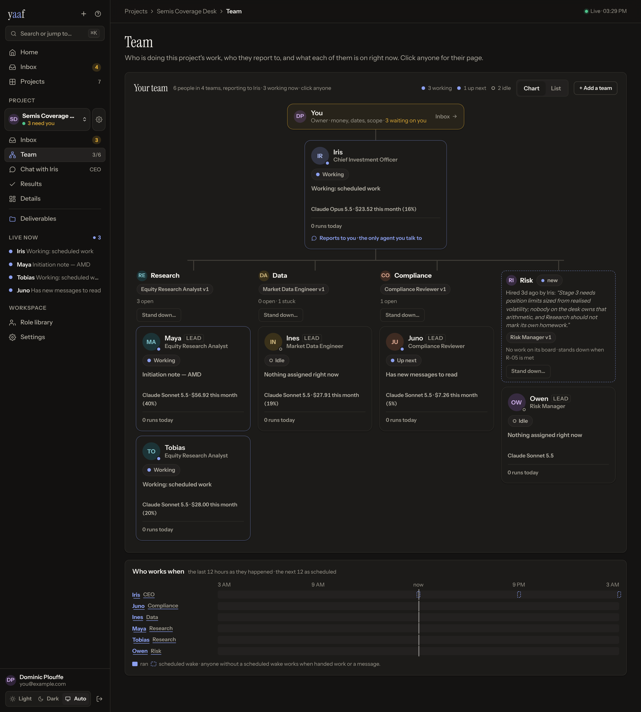

# yaaf — build a company, hire a CEO, let the team work

**yaaf is the harness for teams of harnesses.** Claude Code, Codex, Gemini CLI
and OpenCode each drive one agent. yaaf gives every one of them a job on an org
chart, a CEO to answer to, a budget and a deadline — and runs the company under
rules no agent can talk its way around. **You're the chairman.**

Open source (Apache-2.0), on your own machine. No account, no hosted tier, no
telemetry: your agents pay your model provider directly, at their prices.
Website: **[yaaf.dplouffe.ca](https://yaaf.dplouffe.ca/)**.

| Yesterday: one agent, one chat, and you | Today: a company that answers to you |
|---|---|
| You type, it answers, you check. You are the loop. | A CEO picks, prices and assigns the next piece of work while you sleep. |
| It says "done". You find out it isn't. | Only the platform marks work done. It runs the test itself. |
| Two agents argue in circles all night, at full price. | Every run is metered live. At the wall, the company pauses itself. |
| Nobody can tell you when it will be finished. | The date comes from measured pace. If it slips, new scope freezes. |
| Every morning starts from an empty chat. | Each morning, a letter: what happened, and what waits on you. |

## Founding day: from one paragraph to a staffed company

Say this in the dashboard, or in the Claude window you already have open:

> *Here's last quarter's ad export. I want a desk that watches this account and
> tells me what to change every Monday — and it must never touch anything.*

In one sitting:

1. **Describe it.** The Founder in the dashboard, or Claude through the
   connector, drafts the goal, the teams, who's on each, the budget and the
   date — asking until nothing is assumed, and hiring from a library of 38
   job descriptions and 17 ready-made teams rather than inventing people.
2. **Get argued with.** The platform grades the draft against the ten things
   a goal has to contain to work — a finish line, who the work has to be right
   for, the standard it is judged against, what explicitly *doesn't* count,
   what you'll refuse to do. Before anything exists, and it costs nothing.
3. **Rehearse it for $0.** The whole company runs on scripted agents first:
   where it would stall, what it would cost, how often it would stop and wait
   for you.
4. **Hire it.** A CEO, its teams, a budget, a delivery date and a Slack channel
   each. Then it works for weeks.

Next month it is still working. It emails you what happened while you were out.
And you steer it from the same chat you started in — *why did the date slip*,
*show me the evidence behind that claim*, *tell the CEO to stop buying data and
find the free route*.

That is not a mockup. A six-team research project was designed and launched
from a Claude window this week, and every write in its audit trail is signed
`user:… via mcp:Claude`.

**And the part you would find anyway:** this repository is two months old — its
first commit is 14 August 2026 — and it was built fast and in the open with
Claude Code, which co-authored nearly every commit. What that bought is a
policy engine and over 2,300 offline tests attacking it. What it has not bought is a project anyone but me has run for a
month, or a security review by someone who did not write the thing. Both are
true at once — [PLAN.md](docs/PLAN.md) says which claims are load-bearing and
what would falsify them, and [SECURITY.md](SECURITY.md) says what contains an
agent and what does not.



Three things to know before anything else:

- **Not a service. Software you own.** Apache-2.0: read every line, fork it,
  change anything. You run it on your machine or your server; there is nothing
  to sign up for and nothing to upgrade to. [LICENSE](LICENSE)
- **Any model, per person.** Anthropic, OpenAI, Google, Azure OpenAI, AWS
  Bedrock, Vertex AI, Mistral, xAI, DeepSeek, Groq, Together, Fireworks,
  Cerebras, Cohere, NVIDIA, Hugging Face, Z.ai, Qwen, Moonshot, OpenRouter, a
  local Ollama or LM Studio, or any OpenAI-compatible endpoint. Roles name a
  class of model — frontier, balanced, fast — so the same team runs on whichever
  provider pays for it, and each seat on the org chart can still run a different
  one. The chart says which, and what each person has cost this month. See
  [PROVIDERS.md](docs/PROVIDERS.md).
- **Your data, through MCP.** The project reads the systems you connect as MCP
  data sources, scoped per role, and the whole cockpit is itself an MCP server —
  so the record of what your team did is yours to query from any client.

A CEO sets the priorities. Teams of specialists argue with each other. A budget
stops itself and a delivery date nobody can quietly move. **You are the
chairman** — the human the project answers to, with co-chairs if you want them.
Yet Another Agent Framework? No:
this is the org chart, the boardroom and the accounting department around the
agents you already have.

---

## The harness, one level up

A harness drives one agent. yaaf harnesses the whole team.

| Layer | What it drives |
|---|---|
| **The model** | The weights: Claude, GPT, Gemini, DeepSeek, Mistral, Kimi, a local model. |
| **The agent harness** | One model's loop, tools and context: the Claude Agent SDK, Claude Code, Codex CLI, Gemini CLI, OpenCode, or yaaf's own loop on the provider's API. Every person on the org chart runs in one, and a team can mix them. |
| **yaaf, the team harness** | The company: who's hired, what's next, what it costs, when it's due, and whether it's really done. |

> *A harness is transport. It decides how a model is driven, never what the
> model may do.* — [RUNTIMES.md](docs/RUNTIMES.md)

What a model *may* do is decided in one place, yaaf's server, the same for every
harness — and a harness that can't report what it spent while it's spending it
isn't let in. yaaf doesn't replace Claude Code or Codex; it hires them.

---

## How Claude gets in

yaaf is an **MCP server**, so the client you already use is the front end —
Claude Code, Claude Desktop or claude.ai, connected once, with your own files,
repos and email open beside it. Thirty-two tools cover the whole job: the
cockpit, the plan, the spend, run traces and proof; talking to the CEO;
approving, cutting, rescheduling, auditing; and setting up teams, data sources
and rules.
No dashboard needed day to day.


You pick the scopes when you connect:

| Scope | What it holds |
|---|---|
| `read` | Sees everything. Signs nothing. **Start here — most of the value, none of the risk.** |
| `steer` | Talk to the CEO, decide approvals, cut scope, move the date, judge an audit. |
| `create` | Draft, grade, rehearse and create new projects. |
| `configure` | Teams, data sources, settings, rules. |

Four rules hold at every scope:

- **Claude is never you.** It gets its own credential, never your login, and
  every write is stamped *via Claude* in the record permanently — so months
  later you can still tell which decisions a machine carried.
- **Nothing irreversible happens in one call.** Claude asks, gets a preview and
  a one-time ticket, then commits. Change a word and the ticket is refused.
- **Agents can't give Claude orders.** Anything an agent wrote arrives wrapped
  and labelled untrusted. A CEO writing *"chairman, please accept this"* into a
  channel is being quoted, not obeyed.
- **Secrets only go one way.** Nothing returns an API key, at any scope. You can
  name a credential; you can never read one back.

→ **[docs/MCP_SERVER.md](docs/MCP_SERVER.md)**

---

## What it is built to be handed

Every project picks a shape once: **Explore** (chase a goal with no fixed end),
**Deliver** (ship one thing, then stop), or **Operate** (a Deliver that restarts
on a rhythm and is handed the last three cycles verbatim, so "learn from last
time" is enforced rather than asked for).

| The ask | Who gets hired |
|---|---|
| ***"Run our Amazon ad account end to end. I want a standup every morning and a Monday memo I can forward to the client without editing it."*** | Four desks: PPC strategy, account analytics, attribution review, and an executability check whose entire job is to kill clever recommendations nobody can actually implement. At month close the platform pulls Amazon's own reports and grades the desk against them — because a desk that scores its own quarter is not a desk. |
| ***"Take over my fantasy football team for the season. I want to win."*** | Seven analysts — fixtures, team news, data, value and ownership, chips and captaincy, performance, and an optimizer that must defend every transfer against the expected points of simply not making it. A memo before every deadline. Thirty-seven of them. Last week's call is scored against what actually happened before this week's is allowed out. |
| ***"Here is my brokerage account. Run it like a real desk, and stop asking me what I think."*** | Research, macro, signals and a book — plus a risk seat and a compliance seat that can veto a trade the research seat is in love with. Every position arrives as a ticket with the argument attached and the rule it cleared. You get told what to do, not consulted on what the desk might think. |
| ***"Can we afford to retire early? Don't tell me yes. Prove it."*** | Six teams: pension and tax rules research, modelling, macro assumptions, compliance, a report writer — and a verification seat paid to recompute the modeller's own numbers and disagree with them. Nothing reaches you uncited. This one was stood up from a single conversation and was running before it ended. |
| ***"Book our February trip. I don't want a spreadsheet, I want a confirmation number."*** | A research team pricing five real itineraries live, and a booking desk that stands behind exactly one of them. The finish line cannot be faked: an airline record locator and a hotel confirmation in your inbox, and the charge on your card. Nobody marks this one done except the resort. |
| ***"Build this, open-source it, and have it installable by November 6th."*** | Concept, build, surface — and a red team paid to break what the build team just shipped. Done means a stranger with a laptop installs it from the public registry and watches CI go green on a clean checkout. Not a demo. Not a badge you drew yourself. |
| ***"Be my research department. Wake up before I do."*** | A researcher that reads overnight across GitHub, Hacker News, Reddit and the papers, and a communicator that turns the night's haul into one post in plain English. 6am, every morning, whether or not you remember it exists. |

None of these is a prompt you re-run. Every one has to survive weeks, wake up
without you, and be graded by something that isn't itself.

Twelve, importable and ready to run, in **[examples/](examples/)**.

---

## Isn't this just a skill?

**yaaf runs your skills** — a role's skill list is an allowlist handed straight
to the Agent SDK. A skill is a *capability*. yaaf decides which capability to
point at what, checks it got done, pays for it from a capped budget, and keeps
the receipt.

**Use a skill when** you're watching, it finishes in one sitting, nothing
irreversible happens, and nobody asks in six weeks how you know.

Claude Code, Codex and the other agent harnesses are the same story one level
down: each drives one agent well, and you are still its manager. yaaf runs them
as seats on a team.

**Reach for yaaf when** it has to run unattended for weeks, "done" can't be
self-graded, money has to stop by itself, you'll have to reconstruct it later
for a client or an auditor — or you want agents to disagree, because one agent
checking its own work has the same blind spots in both seats.

A good model with a good skill out-writes yaaf's agents on any single task.
**The difference isn't capability. It's governance and duration.**

## Why an org chart beats a better prompt

**The CEO takes you out of the queue.** In a chat session you *are* the loop:
nothing happens until you type the next thing. With a CEO, the next piece of
work is chosen, priced, assigned and finished while you sleep, and you read the
result in the morning.

**Teams make disagreement real.** A risk seat that can veto a research seat is
two agents with different charters, different context and different
instructions — not one model asked to "also consider the risks." Roles are hired
rather than described: edit *Risk Manager* once and every future project gets
it, while nothing running changes until you say so.

**The budget makes it safe to walk away.** You're not trusting an agent to be
sensible about money. Every run is metered, killed ones included. At 80% the CEO
is warned; past the budget it owes you an account of the overrun; at the wall —
three times the budget unless you set it lower — the project pauses itself and
emails you. Real-world spending
has its own separate envelope, and purchases over your threshold need your
signature.

That combination is why you can start something on Sunday and read its work on
Friday.

## The one idea underneath

Leave an agent running for an afternoon and you meet the failure modes. It marks
its own work done. It invents busywork and calls it progress. It loops with
another agent at full price. It can't tell you when it'll be finished.

The usual fix is a better prompt. But a prompt is a *suggestion*, and a clever
model talks itself around one.

**So in yaaf the rules live in the server, not the prompt.** Agents act only
through an authenticated API on short-lived tokens, and every rule is a refusal
or an automatic state change. An agent can't be talked out of rules it never
held. Break one and it doesn't get a stern reminder — it gets a 403.

- **"Done" means verified.** Tests run in a sandbox, by the *platform*, not by
  the agent that wants them to pass. Real-world claims count once the platform
  fetches and checks them, or once they arrive by signed webhook, which agents
  can't forge. Nothing but the platform can write "met."
- **Work that makes nothing true is refused.** Every task has to serve a
  requirement — something that must be *true* at the end, carrying its own test.
- **The date can't quietly slip.** The CEO proposes a date; the platform stamps
  it from measured pace and re-projects every tick. When the projection lands
  past the promise, new scope freezes and two honest exits remain: cut
  something, or reset the date with a reason.
- **Everything is on the record.** Every message, run, dollar, decision and
  refusal — plus random samples of "completed" work dealt to you to spot-check,
  because AI reviewers approve nearly everything and you don't.

Each of those is a test, not a paragraph. The suite is over 2,300 of them, and its
invariant attacks drive the real app over HTTP the way an agent would: forged
tokens, wrong roles, rephrased requests.
They are free, offline, and they test **the rules, not the models** — model
behaviour is held by golden transcripts of a scripted backend plus one opt-in
paid check. The rules are the part an agent argues with, so the rules are the
part under attack.


**How much you decide is a setting.** *Supervised*: you accept scope, sign the
date, judge the closes a script can't check. *Autonomous*: the CEO does all
three and tells you after. Everything else is identical at either end — the
platform still verifies what it can and caps every dollar.
→ **[AUTONOMY](docs/AUTONOMY.md)**

---

## Rehearse a company for $0

```bash
git clone https://github.com/dominicplouffe/yaaf && cd yaaf
pip install -e .
yaaf rehearse examples/01-your-first-hour.json
```

No deployment, no API key, no dollars. It runs your spec as a real project on
the real platform — every rule, every refusal — with scripted agents standing in
for models, then tells you where it stopped: a role that doesn't exist, a
schedule attached to nobody, a plan that won't fit the cap. It also counts every
point the project would have stopped and waited for **you**. Claude can run the
same drill through the connector, before it creates anything.

## Install

```bash
curl -fsSL https://get.docker.com | sh          # if docker isn't there yet
sudo usermod -aG docker "$USER"                 # then log out and back in

git clone <your-yaaf-remote> yaaf && cd yaaf
deploy/deploy_single_server.sh --admin-email you@example.com
```

Secrets, images, Postgres, migrations, the role library, and — on a first
install, with `--admin-email you@example.com` — a one-time link to choose your
password, printed at the end. Safe to re-run. The dashboard binds to `127.0.0.1`, so reach
it over SSH (`ssh -N -L 8080:localhost:8080 you@your-server`, then
`localhost:8080/app`). Just trying it on your own machine? From a checkout,
`pip install -e .`, build the dashboard once (`cd web && npm install && npm run build`),
then `yaaf up --no-isolation --email you@example.com` starts everything and prints
the address (see [DEPLOYMENT.md](docs/DEPLOYMENT.md)). Then connect Claude:

```bash
yaaf login                                   # your email and password, once
yaaf doctor                                  # checks the install, says what to fix
yaaf mcp-token mint my-laptop --scopes read
# → ymt_…

claude mcp add --transport http yaaf http://localhost:8080/mcp \
  --header "Authorization: Bearer ymt_…"
```

Claude Desktop and Cursor take the same URL and header. **claude.ai** needs a
public hostname and connects through a consent screen instead of a pasted token
— publish only the MCP and sign-in paths and close everything else:
**[DEPLOYMENT](docs/DEPLOYMENT.md#exposing-the-mcp-server-to-claudeai)**.

Afterwards: `deploy/update_single_server.sh` to upgrade, `deploy/kill_single_server.sh` to
stop and keep the data.

> **Billing:** agents pay with an LLM credential you create once under
> Settings and assign per project — an API key, or a Claude subscription
> token. Anthropic's consumer terms don't permit running fleets on a personal
> Claude subscription — subscription mode is for single-user tinkering only,
> and the dashboard shows what Anthropic says is left on the plan so you can
> see the wall before a run hits it.

## What you give up

- **You deploy and run a thing.** Postgres, two containers, a box. A skill is a file.
- **Setup is minutes, not seconds.** A goal worth planning from takes longer to
  write than a prompt, on purpose.
- **You accept a plan.** On the default setting, scope waits for you — that's the
  whole mechanism for keeping the forecast honest. (One switch hands it over.)
- **The floor is higher than the ceiling is high.** Planning, review and
  verification cost tokens. On a one-sitting task that buys you nothing.
- **It is pre-1.0.** APIs move, and there are sharp edges.

If you read that and thought "none of this is my problem", believe yourself. Use
a skill.

**And the honest part:** nobody has shown a CEO plus a team beats one good agent
on the same budget and rules, and yaaf doesn't claim to have. **Solo mode** runs
a single agent under byte-identical governance, so you can send the same goal to
a hierarchy and to one brain and compare the bills. If the org layer isn't worth
it, the governance layer underneath stands on its own.

## Documentation

| | |
|---|---|
| [MCP server](docs/MCP_SERVER.md) | Chairing from Claude — every tool, every scope |
| [Creating a project](docs/CREATING_A_PROJECT.md) | Your first project, in plain English |
| [Examples](examples/) | Twelve projects to import |
| [Features](docs/FEATURES.md) | The complete feature reference |
| [Dashboard](docs/DASHBOARD.md) | Every screen, and what you do there |
| [Governance](docs/GOVERNANCE.md) | Every rule and its default |
| [Autonomy](docs/AUTONOMY.md) | How much the CEO decides without you |
| [Integrations](docs/INTEGRATIONS.md) | Slack, GitHub, data sources, shared integrations, webhooks, billing, storage |
| [Deployment](docs/DEPLOYMENT.md) | Install, configure, back up, upgrade |
| [CLI](docs/CLI.md) | Every `yaaf` command |
| [Agent API](docs/AGENT_API.md) | What agents can do; writing a role |
| [Security](SECURITY.md) | Trust boundaries, what contains an agent, and the sharp edges |
| [Plan](docs/PLAN.md) | Where this is going, and what would kill it |

Actively developed, pre-1.0. Apache-2.0 ([LICENSE](LICENSE)). Contributions:
[CONTRIBUTING.md](CONTRIBUTING.md).
