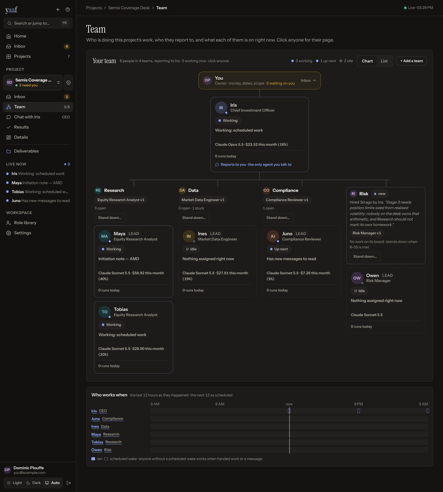

# yaaf

**Run a team of AI agents like a company.** You describe a goal. yaaf hires a
CEO and teams of specialist agents, gives them a budget and a deadline, and
keeps them working for weeks. You stay in charge as the chairman.

The rules live in the server, not in the prompt. An agent cannot mark its own
work done, overspend, or quietly move the deadline. If it tries, the server
says no.

Open source (Apache-2.0). Runs on your machine or your server. No account, no
hosted service, no telemetry. Website: [yaaf.dplouffe.ca](https://yaaf.dplouffe.ca/).



## What you get

- **A CEO that plans the work.** It picks the next task, assigns it, and checks
  the result while you are away. Each morning you get a letter: what happened,
  and what needs you.
- **"Done" means verified.** The platform runs the tests itself. An agent's
  word is not enough.
- **A budget that stops itself.** Every run is metered. At the limit, the
  project pauses and tells you.
- **An honest deadline.** The date comes from measured pace. If it slips, new
  work freezes until you cut scope or reset the date.
- **Any model, per seat.** Anthropic, OpenAI, Google, Mistral, DeepSeek, a
  local Ollama, and many more. Agents run in Claude Code, Codex, Gemini CLI,
  OpenCode, or yaaf's own loop. See [PROVIDERS.md](docs/PROVIDERS.md).
- **A full record.** Every message, run, dollar and decision is kept.
- **Works from Claude.** yaaf is an MCP server, so you can run it from Claude
  Code, Claude Desktop or claude.ai.

## Quick start

Pick one.

**Try it for $0.** No server, no API key. Scripted agents run a real project
and show you where it would stall and what it would cost.

```bash
git clone https://github.com/dominicplouffe/yaaf && cd yaaf
python3 -m venv .venv && .venv/bin/pip install -e .     # Python 3.12+
.venv/bin/yaaf rehearse examples/01-your-first-hour.json
```

**On a server, with Docker.** The recommended way to run it for real.

```bash
git clone https://github.com/dominicplouffe/yaaf && cd yaaf
deploy/deploy_single_server.sh --admin-email you@example.com
```

**On your own computer, without Docker.** Linux only (Arch, Debian, Ubuntu).

```bash
git clone https://github.com/dominicplouffe/yaaf && cd yaaf
deploy/install_desktop.sh
```

Then open **http://localhost:24247/app**, sign in, add a model key under
**Settings → Providers**, and create a project: click **New Project**, or from a
terminal run `yaaf create-project "what you want, in your own words"`. Add
`--quick` to skip the questions and have it running in about a minute.

Full steps: **[docs/INSTALL.md](docs/INSTALL.md)**.

## Connect Claude

```bash
yaaf login
yaaf mcp-token mint my-laptop --scopes read
claude mcp add --transport http yaaf http://localhost:24247/mcp \
  --header "Authorization: Bearer ymt_…"
```

Start with the `read` scope. Add `steer`, `create` or `configure` when you
want Claude to do more.

## How it works

```
 You (dashboard · CLI · Claude)
              │
              ▼
   yaaf server ── rules, budget, schedule ──► database
              │
              ▼
   yaaf runner ── one sandbox per run ──► agent ──► model provider
```

The **server** holds every rule and decides when an agent should wake. The
**runner** starts each agent run in a fresh sandbox. Agents act only through
the server's API, with short-lived tokens. More in
**[docs/ARCHITECTURE.md](docs/ARCHITECTURE.md)**.

## Documentation

| Guide | What's in it |
|---|---|
| [Install](docs/INSTALL.md) | Docker, native, and from source |
| [Configuration](docs/CONFIGURATION.md) | Every environment variable |
| [Deployment](docs/DEPLOYMENT.md) | Running it on a server: updates, backups, going public |
| [Architecture](docs/ARCHITECTURE.md) | How the pieces fit |
| [Models and providers](docs/PROVIDERS.md) | Which models it runs on, keys, prices, local models |
| [The `yaaf` command](docs/CLI.md) | Every command, by task |

## Good to know

- **It is pre-1.0.** APIs still change.
- **It costs real money.** Agents pay your model provider directly, with your
  key. Use `yaaf rehearse` first.
- **It is not for quick tasks.** For a one-off job you watch, a single agent is
  cheaper. yaaf is for work that runs unattended for days or weeks.
- **Security.** Read [SECURITY.md](SECURITY.md) before you run agents on a
  machine that matters.

## License

Apache-2.0. See [LICENSE](LICENSE). To contribute, read
[CONTRIBUTING.md](CONTRIBUTING.md).
