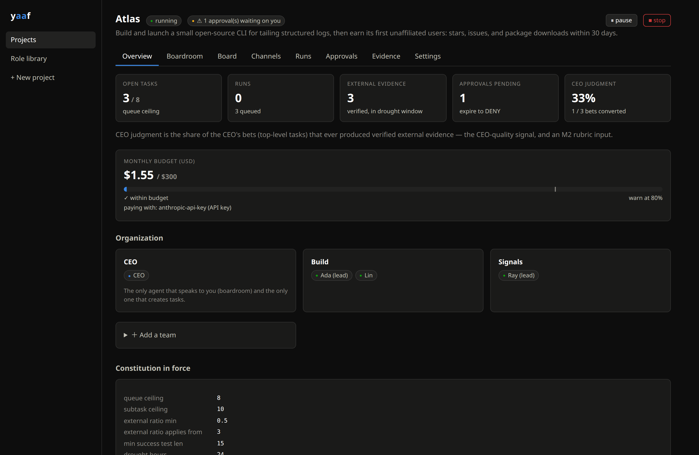
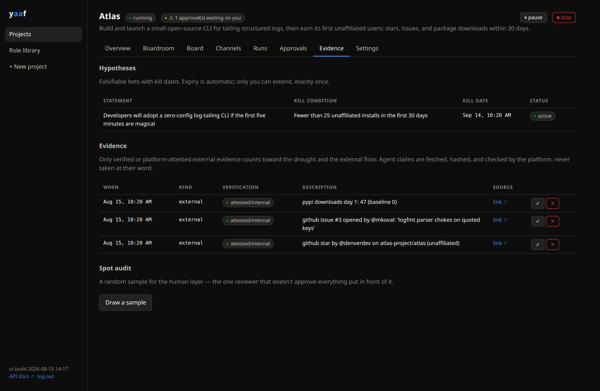

# yaaf — Yet Another Agent Framework

**Run a small AI company on your own hardware — with rules the agents can't
talk their way out of.**

yaaf runs a company of AI agents: a **CEO** that plans and prioritizes, teams
of **role-based agents** that do the work (engineer, researcher, writer,
marketer…), and **you as chairman** — the one human, with a small set of real
powers. It keeps working while you're away: agents wake on schedule or when
something needs them, do one unit of work, and go back to sleep. Everything
runs on your own machine with Docker Compose, and you watch and steer from a
web dashboard.



## The problem

Anyone who has left an autonomous agent running for more than an afternoon has
met the failure modes:

- It marks its own work "done" without anything actually being done.
- It invents busywork and reports it as progress.
- Two agents thank each other in a loop, at full API price, for hours.
- It spends your budget while you sleep.
- You come back and can't reconstruct what happened or why.

The usual fix is better prompts. But a prompt is a *suggestion* — a
sufficiently confused (or sufficiently clever) model can always talk itself
around one.

**yaaf's core idea: the rules live in the server, not in the prompt.** Agents
can only act through an authenticated API using short-lived, per-run tokens,
and every rule is enforced as an API refusal or an automatic state change. An
agent cannot be talked out of rules it never held. When an agent tries to
break a rule, it doesn't get a stern reminder — it gets a 403.

## What that looks like in practice

- **Work is pulled, never invented.** Only the CEO creates tasks, every task
  needs a success test that can actually fail (a command the *platform* runs,
  or a checkable observable), and there's a hard ceiling on open work.
- **"Done" means verified.** Completions need evidence; claims of real-world
  impact ("someone starred the repo", "we got a signup") only count after the
  platform fetches, checks, and snapshots them — or when they arrive through
  connectors agents can't forge (signed webhooks from GitHub, Slack, or
  anything you wire up).
- **Money can't run away.** Every run is metered (even killed ones). At 80% of
  budget the CEO gets warned; at 100% the project pauses itself and you get an
  email. Circuit breakers kill message loops and refusal storms before they
  cost anything.
- **Agents are contained, not trusted.** Each run happens in a fresh Docker
  container whose only network route is an allowlist proxy — per role, so your
  writer can reach WordPress and nothing else. Secrets are encrypted, scoped
  to roles, and injected per-run; agents never see the values in chat.
- **Everything is on the record.** Every message, task transition, run, dollar,
  and rule enforcement is in Postgres and visible in the dashboard. The
  dashboard also deals you random samples of recent "completed" work and
  evidence to spot-check — because AI reviewers approve nearly everything, and
  you don't.
- **The rules themselves are stable.** Each project freezes its rulebook (the
  "constitution") at creation. You can amend it, but amendments take 72 hours
  to land, are disclosed to the CEO, and are logged — so nobody, including
  you at 2am, quietly loosens the rules.



## How is this different from a standalone agent?

A standalone agent (a chat assistant, a CLI coding agent) is a brilliant
*tool*: you aim it, it works, you check the result. The discipline comes from
you being there.

yaaf is for the moment you stop being there. It supplies the things a lone
agent doesn't have: something that decides what to work on next (and what to
kill), a definition of "done" that isn't self-graded, budgets that actually
stop spending, memory with a curator instead of an ever-growing scratchpad,
and a complete record you can audit later. You go from *operating a tool* to
*chairing an organization* — you speak only to the CEO, decide approvals, and
spot-check the work.

## How is this different from CrewAI / AutoGen / LangGraph?

Those are **libraries**: you write a program that wires agents into a
workflow, and the workflow lives while your program runs. They're excellent
for building agent-powered *applications*, and yaaf is not trying to be one.

yaaf is a **platform** you deploy — closer to "self-hosted GitLab for an AI
workforce" than to an orchestration SDK:

| | Agent libraries | yaaf |
|---|---|---|
| Lifespan | While your script runs | Weeks — event-driven wakes, schedules, heartbeats |
| Where rules live | In prompts and your code | In the server, as refusals it's not possible to bypass |
| "Task complete" | The model says so | Platform-run success tests, verified evidence, human spot-audit |
| Cost control | You watch the meter | Metered runs, hard budget pauses, loop circuit breakers |
| Isolation | Your process, your network | Container per run, egress allowlist per role, scoped secrets |
| After a crash | Re-run the script | Leases reaped, work released, side-effects ledger prevents double-firing (no duplicate tweet, PR, or payment) |
| Paper trail | Your logs | Full audit: every message, decision, dollar, and enforcement |

If you want to *build an app that uses agents*, use a library. If you want to
*run agents unattended on real goals with real budgets*, that's yaaf.

## The honest part

Multi-agent hierarchies are mostly vibes right now — nobody has shown that a
CEO + team beats one good agent with the same budget and rules. yaaf doesn't
assume it either: the repo ships a controlled experiment
([docs/M2_PROTOCOL.md](docs/M2_PROTOCOL.md), `yaaf experiment`) that runs an
org arm against a single-agent arm under identical governance, blind-judges
the results, and applies a pre-registered decision rule. If the org loses,
the org part of this framework gets shelved — and the governance layer
(queues, verification, budgets, audit, sandbox) still stands on its own for
single agents. Either way, you get the answer instead of the vibes.

## Quickstart

**Dev mode — five minutes, no Docker, $0** (agents are scripted stand-ins):

```bash
python3 -m venv .venv && .venv/bin/pip install -e ".[dev]"
.venv/bin/python -m pytest tests/            # the whole suite runs offline

export YAAF_DATABASE_URL=sqlite:////tmp/yaaf.db YAAF_ADMIN_TOKEN=dev-admin-token \
       YAAF_SANDBOX_MODE=subprocess
.venv/bin/python -c "from yaaf.core.db import engine; \
  from yaaf.core.models import Base; Base.metadata.create_all(engine())"
.venv/bin/yaaf-server &                      # API + dispatcher + janitor
export YAAF_API=http://localhost:8080
.venv/bin/yaaf seed-roles roles/
```

Then open **http://localhost:8080/app**, log in with the admin token, and
create a project from the wizard.

**The real thing — Docker Compose** (real Claude agents, sandboxed):

```bash
sudo mkdir -p /var/lib/yaaf/workspaces /var/lib/yaaf/artifacts
docker build -f deploy/sandbox/Dockerfile -t yaaf-sandbox:latest .
cd deploy && YAAF_ADMIN_TOKEN=… YAAF_MASTER_KEY=… docker compose up --build
```

That starts Postgres, the API + web dashboard, the runner, and the egress
proxy. Open the dashboard, create a project, connect billing in Settings (an
Anthropic API key), give your teams their credentials, and press start.
Migrations apply themselves; `--profile s3` adds a MinIO artifact store.

> **Billing note:** agents pay with an API key you attach per project.
> Anthropic's consumer terms don't permit running fleets on a personal Claude
> subscription — subscription mode exists for single-user tinkering only.

## What's in the box

```
yaaf/server     the platform: API, policy engine (the refusals), dispatcher,
                janitor, evidence verifier, Slack bridge, egress generator
yaaf/runner     leases runs, launches sandbox containers, meters everything
yaaf/cli        `yaaf` — admin/observe CLI, incl. `yaaf experiment`
web/            the chairman's dashboard (React, served at /app)
roles/          starter role library (CEO, engineer, researcher, writer…)
evals/          golden-transcript evals — regression-gate for prompt edits
tests/          invariant suite that attacks every rule over HTTP, chaos
                tests, and the eval checks; CI runs it all on SQLite + Postgres
docs/PLAN.md    the founding plan, kill conditions included
```

Integrations, all optional, all configured from the dashboard or one API
call: **Slack** (mirror your company's channels; reply to the CEO from
Slack), **GitHub** (private repo per project as the agents' workspace;
repo events become verified evidence), **external MCP servers** (declare one
on a role, store its URL as a role-granted credential, and that role's
sandboxes mount its tools — other roles never see it), **WordPress** or any
HTTP service via scoped credentials, **email/webhook notifications** when
the chairman is needed, and **S3-compatible artifact storage**.

## Project status

Actively developed, pre-1.0, APIs still moving. The platform (governance,
sandbox, integrations, dashboard, eval + chaos suites, CI) is built and
tested; the org-vs-single-agent experiment is the current milestone. One
production project runs on it daily. Expect sharp edges; read
[docs/PLAN.md](docs/PLAN.md) for where this is going and what would kill it.
