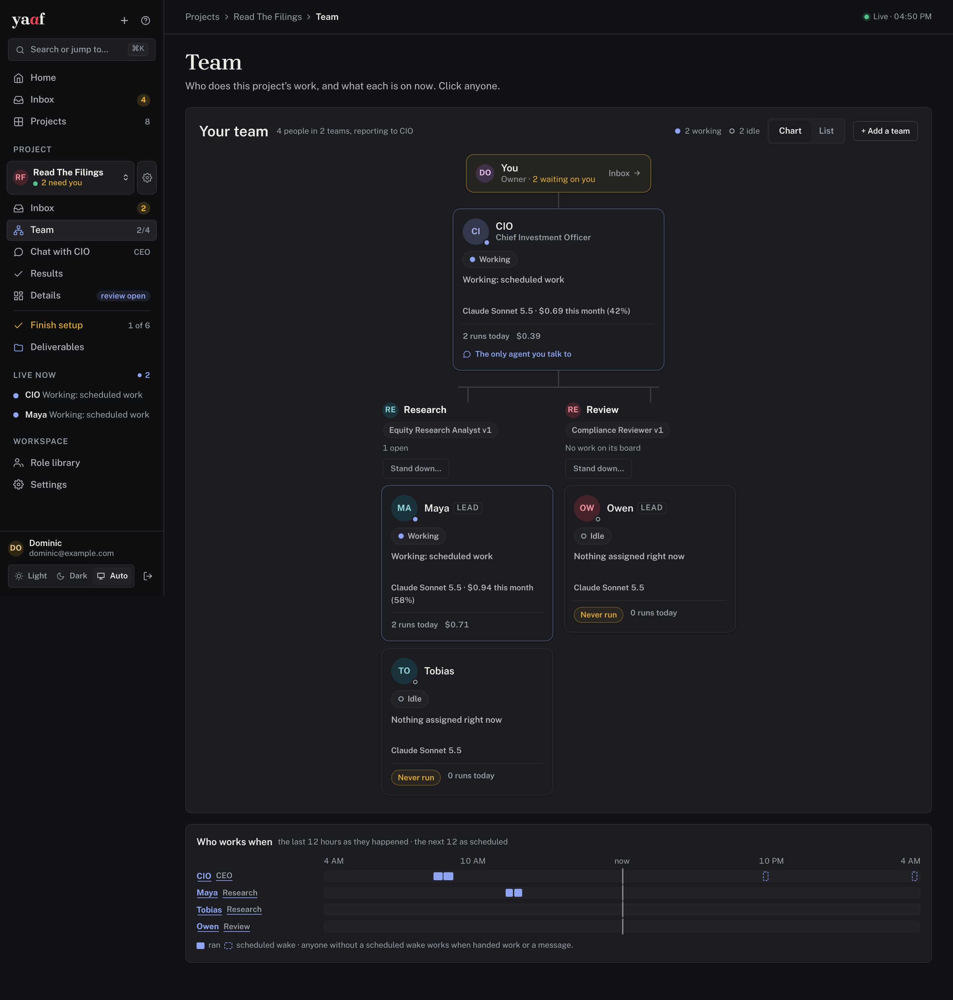
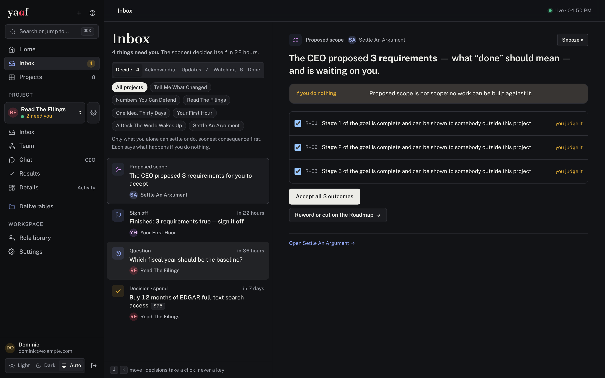
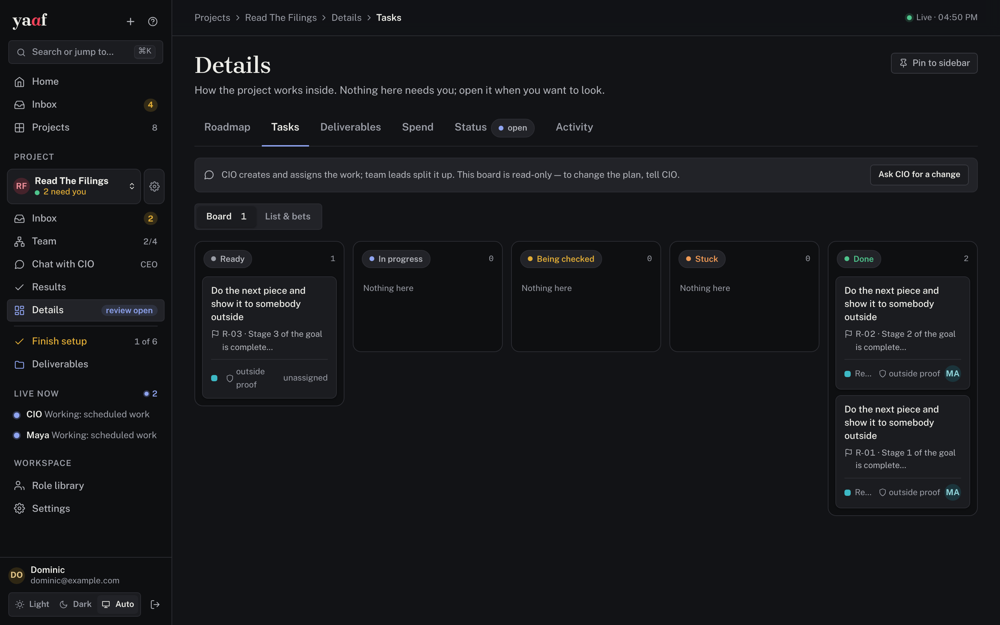
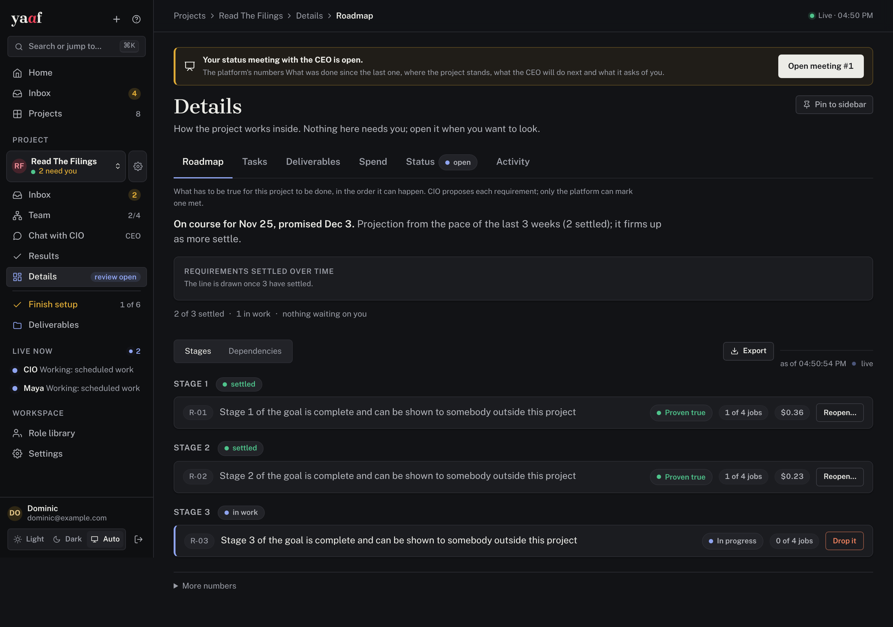
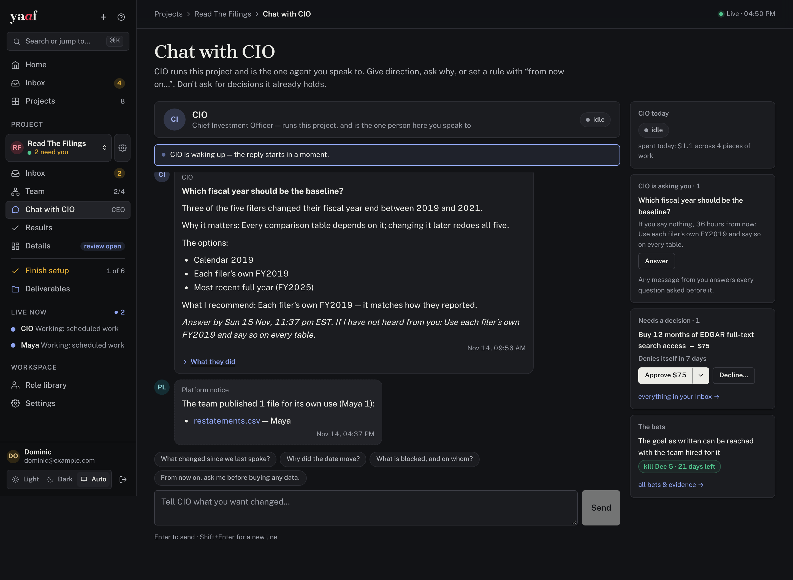

<div align="center">

<picture>
  <source media="(prefers-color-scheme: dark)" srcset="docs/brand/logo/yaaf-primary-on-dark.svg">
  
</picture>

> *"You wrote this. The whole value of the read is that somebody who did not
> write it looked at it — reviewing your own work is the thing this state
> exists to prevent."*
>
> — the yaaf server, refusing an agent (HTTP 403)

[](LICENSE)
[](https://python.org)
[](CHANGELOG.md)
[](https://github.com/dominicplouffe/yaaf/actions/workflows/ci.yml)
[](#connect-claude)

<br>

Your agent said the work was done, and it wasn't?<br>
Your agent ran all weekend and spent the budget you meant for the month?<br>
Your agent quietly moved the deadline, and told you on the day it was due?<br>
Your agent graded its own homework, and gave itself an A?<br>

**Run a team of AI agents like a company — under rules they can't talk their way out of.**

<br>

Describe a goal in your own words.<br>
yaaf hires a CEO and teams of specialists, gives them a budget and a deadline,<br>
and keeps them working for **days or weeks** while you stay in charge as the chairman.

[Install](#install) · [Usage](#usage) · [Demo](#demo) · [Features](#features) · [Examples](#example-projects) · [Docs](#documentation) · [Website](https://yaaf.dplouffe.ca/)

</div>

---

Open source, Apache-2.0. Runs on your machine or your server. **No account, no
hosted service, no telemetry.** Agents pay your model provider directly, with
your key.



## The one idea

**The rules live in the server, not in the prompt.** Agents never touch the
database. They act only through yaaf's API, with a short-lived token scoped to
one run. Every rule is either a refusal or an automatic state change:

| An agent tries to… | The server… |
|---|---|
| Mark its own work done | Runs the success test itself. An agent's word is not evidence. |
| Review its own work | Refuses (403). Only a reviewing seat closes a read. |
| Keep spending past the cap | Pauses the project at the limit and tells you. |
| Quietly let the deadline slip | Freezes new work until you cut scope or reset the date. |
| Wake itself over and over | Holds it to a per-agent, per-hour and per-day run ceiling. |

An agent cannot argue its way past code that never asked its opinion.

---

## Supported Models & Harnesses

Every seat on the org chart can run on a different provider and a different
agent harness. One budget per project meters all of them.

| Provider | Key | Searches the web itself | Model classes set for you |
|---|:---:|:---:|:---:|
| Anthropic | API key or subscription | ✅ | ✅ |
| OpenAI | API key or ChatGPT login | ✅ | ✅ |
| Google (Gemini) | API key or Google login | ✅ | ✅ |
| Google Vertex AI | Service account | ✅ | from your key |
| Azure OpenAI | API key + resource | ✅ | — |
| AWS Bedrock | API key + region | — | — |
| DeepSeek, Mistral | API key | — | ✅ |
| xAI, Moonshot, Z.ai, Qwen, Cohere | API key | — | from your key |
| OpenRouter, Groq, Together, Fireworks, Cerebras, NVIDIA NIM, Hugging Face | API key | — | — |
| Ollama, LM Studio | Address only | — | — |
| Any OpenAI-compatible server | Address + key | — | — |

| Harness | What runs the agent |
|---|---|
| **Claude Code** | Anthropic's agent, via the CLI or the Agent SDK |
| **Codex** | OpenAI's coding agent |
| **Gemini CLI** | Google's agent |
| **OpenCode** | Any provider above |
| **yaaf loop** | yaaf's own tool loop, for any provider above |

Roles name a *class* of model — `@frontier`, `@balanced`, `@fast` — not a model,
so changing a provider's lineup once moves every seat. Full details in
**[docs/PROVIDERS.md](docs/PROVIDERS.md)**.

---

## Install

> **Try it first.** No server, no API key. Scripted agents run a real
> project and show you where it would stall and what it would cost.

```bash
git clone https://github.com/dominicplouffe/yaaf && cd yaaf
python3 -m venv .venv && .venv/bin/pip install -e .     # Python 3.12+
.venv/bin/yaaf rehearse examples/01-your-first-hour.json
```

### On a server, with Docker (recommended)

```bash
git clone https://github.com/dominicplouffe/yaaf && cd yaaf
deploy/deploy_single_server.sh --admin-email you@example.com
```

### On your own computer, without Docker

Linux only (Arch, Debian, Ubuntu). Agents run in a bubblewrap jail.

```bash
git clone https://github.com/dominicplouffe/yaaf && cd yaaf
deploy/install_desktop.sh
```

| | Docker | Native | From source |
|---|---|---|---|
| **For** | A server, or running it for real | Your own Linux desktop | Working on yaaf itself |
| **Agents run in** | A fresh container per run | A bubblewrap jail per run | A plain process |
| **Database** | Postgres | SQLite | SQLite |

> Every option, prerequisite and troubleshooting step is in
> **[docs/INSTALL.md](docs/INSTALL.md)**.

---

## Usage

Open **http://localhost:24247/app**, sign in, and add a model key under
**Settings → Providers**. Then create a project — from the dashboard
(**New Project**) or from a terminal:

```bash
yaaf create-project "A weekly digest of what changed in our competitors' pricing"
```

The Founder drafts the whole project — goal, mode, team and rules — and asks
about anything it had to guess. Add `--quick` to skip the questions and have it
running in about a minute.

### Commands

| Command | Description |
|---|---|
| `yaaf rehearse SPEC` | Run a project with scripted agents, no key needed |
| `yaaf create-project "BRIEF"` | Describe a project in words; the Founder drafts it |
| `yaaf create-project --from-file SPEC` | Create a project from a spec in `examples/` |
| `yaaf projects` | Every project: status, spend, and what waits on you |
| `yaaf status` | Is everything OK, in plain sentences |
| `yaaf desk` | What needs you, one decision at a time, in the terminal |
| `yaaf start P` / `pause P` / `stop P` | Start or resume, pause, or end a project |
| `yaaf amend P` | Change one of the project's rules |
| `yaaf open` | Open the dashboard in your browser |
| `yaaf doctor` | Check the whole install and say how to fix what's wrong |
| `yaaf update` | Back up, pull, rebuild what changed, restart |

Every command takes `--help`. The full list is in **[docs/CLI.md](docs/CLI.md)**.

### Connect Claude

yaaf is an MCP server, so you can run it from Claude Code, Claude Desktop or
claude.ai:

```bash
yaaf login
yaaf mcp-token mint my-laptop --scopes read
claude mcp add --transport http yaaf http://localhost:24247/mcp \
  --header "Authorization: Bearer ymt_…"
```

Start with the `read` scope. Add `steer`, `create` or `configure` when you want
Claude to do more.

---

## Demo

> Input: `yaaf rehearse examples/01-your-first-hour.json` — real output, trimmed.

```
Fire drill — Your First Hour (deliver)
========================================================================

The walk
  ✓ Project created — deliver · 1 team(s), 2 agent(s)
  ✓ The CEO proposed a plan — 3 requirement(s), 12 estimated runs   beat 1
  ✓ The plan gate closed — the board opened — the plan is staged,
    estimated and fits the money                                    beat 2
  ✓ Work was claimed — an agent picked it up                        beat 4
  ✓ Evidence was filed — 1 row(s) filed                             beat 4
  ✓ A delivery date was proposed — platform-projected               beat 3
  ✓ A requirement settled true — R-01 — the platform ran the test   beat 4

It stopped and waited for you 7 time(s)
  · 3× accept scope
  · 3× judge an observable
  · 1× sign the date

What it will cost
  it fits your $20 cap if a run costs under $1.67

What it still needs before it can really run
  ! Nobody on this team is there to disagree with the CEO's plan.
    Hire a role whose job is to challenge the plan.
```

The rehearsal doesn't just say *it works*. It tells you every morning your
project would sit idle waiting for you, what it would cost, and what's missing
from the team.

<table>
  <tr>
    <td width="50%"><br><sub><b>Inbox</b> — what needs you, one decision at a time</sub></td>
    <td width="50%"><br><sub><b>Work &amp; proof</b> — nothing closes without evidence</sub></td>
  </tr>
  <tr>
    <td width="50%"><br><sub><b>Plan &amp; promise</b> — a date from measured pace</sub></td>
    <td width="50%"><br><sub><b>Boardroom</b> — talk to your CEO</sub></td>
  </tr>
</table>

---

## Features

### A company, not a chatbot

| Part | What it does |
|---|---|
| **Chairman** (you) | Sets the goal, the budget and the rules. Decides what the CEO can't. |
| **CEO** | Plans the work, picks the next task, assigns it, checks the result. Writes you a letter each morning: what happened, and what needs you. |
| **Teams** | Specialists — engineers, analysts, writers, editors, skeptics, adversaries — each on the model and harness you choose. |
| **Reviewers** | Read finished work they did not write. A red team can block delivery. |

Flow: `Goal → CEO plans → you accept scope → teams claim work → the platform verifies → you sign off`

### Five kinds of project

| Mode | For |
|---|---|
| **deliver** | A finished thing by a date: a report, a tool, a game |
| **operate** | A standing job that runs every day or week: a triage desk, a digest, an overnight crew |
| **explore** | An open question with a time box: find one idea worth building, and prove it |
| **code_factory** | Software, built and then kept: from an empty repo to v1.0 by a date, then weekly upkeep. Or adopt a repo you already have and keep it patched and shipping |
| **ppc_factory** | An Amazon advertising account, investigated through the MCP data source that holds it by a crew carrying a strategist's playbook: what the business can afford to pay for a sale, what works, what does not, where 10k–100k more a month would go, and a week-by-week plan. The platform holds what makes it trustworthy — every number cites a recorded pull of Amazon data, and the audit is a draft until a separate reviewer passes it ([plan](docs/plans/amazon-ppc-factory.md)) |

### Guardrails that hold

- **Verified "done"** → the platform runs the tests itself
- **Metered budget** → every run is priced; at the cap, the project pauses
- **Honest deadline** → the date comes from measured pace; if it slips, new work freezes
- **Autonomy dial** → you choose which decisions park for you and which the CEO takes
- **Sandboxed runs** → one fresh container or bubblewrap jail per agent run
- **A full record** → every message, run, dollar and decision is kept

---

## Example Projects

Fourteen ready-made specs in [`examples/`](examples/). Rehearse any of them
first, then create it for real with `yaaf create-project --from-file`.

| Spec | Mode | What it does |
|---|---|---|
| [`01-your-first-hour`](examples/01-your-first-hour.json) | deliver | One 800-word briefing note on a subject you pick |
| [`02-settle-an-argument`](examples/02-settle-an-argument.json) | deliver | Answer one question with evidence you could defend |
| [`03-a-desk-the-world-wakes`](examples/03-a-desk-the-world-wakes.json) | operate | A standing triage desk fed by a signed webhook |
| [`04-an-overnight-crew`](examples/04-an-overnight-crew.json) | operate | Keep a repository healthy, overnight, without you |
| [`05-a-tutor-that-adapts`](examples/05-a-tutor-that-adapts.json) | operate | One lesson a week, re-planned around what you get wrong |
| [`06-a-red-team`](examples/06-a-red-team.json) | deliver | Build a small tool, then prove it robust by failing to break it |
| [`07-tell-me-what-changed`](examples/07-tell-me-what-changed.json) | operate | A weekly digest of only the changes that matter to you |
| [`08-a-game-you-can-play`](examples/08-a-game-you-can-play.json) | deliver | A one-screen browser game in a single HTML file |
| [`09-one-idea-thirty-days`](examples/09-one-idea-thirty-days.json) | explore | One product idea, with proof someone else wants it |
| [`10-read-the-filings`](examples/10-read-the-filings.json) | deliver | An initiation note built only from SEC EDGAR filings |
| [`11-numbers-you-can-defend`](examples/11-numbers-you-can-defend.json) | deliver | An answer from public data a skeptic could re-derive |
| [`12-a-content-engine`](examples/12-a-content-engine.json) | operate | Publish posts that earn a reader, on a subject you know |
| [`13-a-booking-app`](examples/13-a-booking-app.json) | code_factory | A booking web app built from an empty repo to v1.0, then kept weekly |
| [`14-keep-a-repo-healthy`](examples/14-keep-a-repo-healthy.json) | code_factory | Adopt a repo you already have: read it, propose a charter, keep it patched and shipping |
| [`15-an-amazon-ppc-audit`](examples/15-an-amazon-ppc-audit.json) | ppc_factory | Audit an Amazon ads account through its data source, and price where more spend would go |

---

## How It Works

```
 You (dashboard · CLI · Claude)
              │
              ▼
   yaaf server ── rules, budget, schedule ──► database
              │
              ▼
   yaaf runner ── one sandbox per run ──► agent ──► model provider
```

The **server** holds every rule and decides when an agent should wake. The
**runner** starts each agent run in a fresh sandbox. Agents act only through
the server's API, with short-lived tokens. More in
**[docs/ARCHITECTURE.md](docs/ARCHITECTURE.md)**.

### Project Structure

```
yaaf/
├── yaaf/
│   ├── server/       # The API, policy engine (the rules), dispatcher, janitor
│   ├── runner/       # Leases queued runs, starts sandboxes, meters cost
│   ├── runtimes/     # Providers, harnesses, model catalog and prices
│   ├── founder/      # Turns a brief in plain words into a project
│   ├── rehearsal/    # The fire drill with scripted agents
│   ├── core/         # Models, config, crypto, shared plumbing
│   └── cli/          # The `yaaf` command
├── web/              # The dashboard (React + Vite)
├── roles/            # Role definitions: CEO, engineer, editor, adversary, …
├── crews/            # Ready-made teams
├── examples/         # Project specs you can rehearse or run
├── deploy/           # Docker, native installer, single-server script
├── migrations/       # Alembic database migrations
├── tests/            # ~1,350 integration tests against the real app
└── docs/             # Install, configuration, deployment, architecture, CLI
```

---

## Documentation

| Guide | What's in it |
|---|---|
| [Install](docs/INSTALL.md) | Docker, native, and from source |
| [Configuration](docs/CONFIGURATION.md) | Every environment variable |
| [Deployment](docs/DEPLOYMENT.md) | Running it on a server: updates, backups, going public |
| [Architecture](docs/ARCHITECTURE.md) | How the pieces fit |
| [Models and providers](docs/PROVIDERS.md) | Which models it runs on, keys, prices, local models |
| [The `yaaf` command](docs/CLI.md) | Every command, by task |
| [Changelog](CHANGELOG.md) | One release per week |

---

## Notes

- **It is pre-1.0.** APIs still change. A release ships every week.
- **It costs real money.** Agents pay your model provider directly, with your
  key. Run `yaaf rehearse` first.
- **It is not for quick tasks.** For a one-off job you watch, a single agent is
  cheaper. yaaf is for work that runs unattended for days or weeks.
- **Security matters here.** yaaf runs models with credentials, a shell and a
  network, unattended. Read [SECURITY.md](SECURITY.md) before you run agents on
  a machine that matters.
- **Contributing:** the house rules in [CONTRIBUTING.md](CONTRIBUTING.md) *are*
  the product. Every rule ships with a test that attacks it.

---

<div align="center">

Apache-2.0 · Made by [@dominicplouffe](https://github.com/dominicplouffe) · [yaaf.dplouffe.ca](https://yaaf.dplouffe.ca/)

</div>
