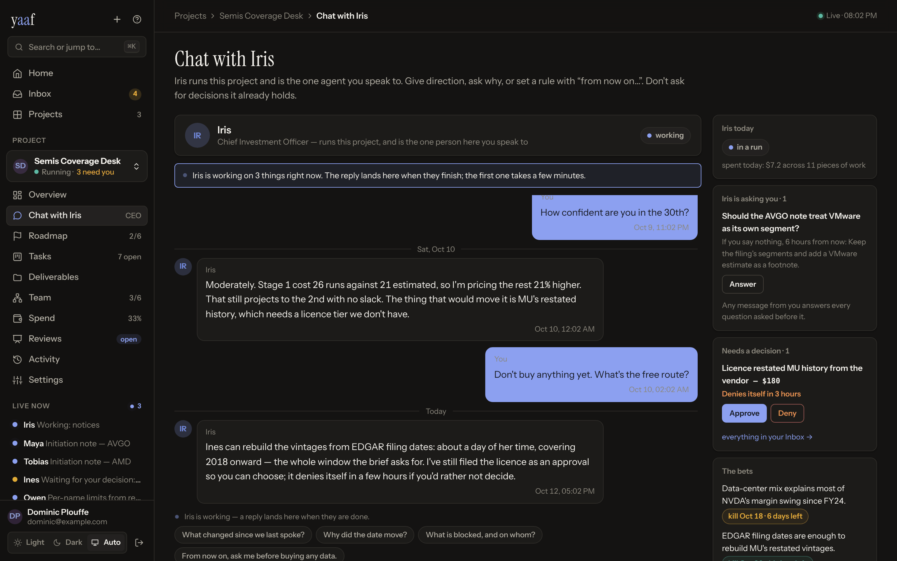

# The dashboard — every screen, and what you do there

The chairman's cockpit is a React SPA served by the API at **`/app`**. Log in
with your admin token (`YAAF_ADMIN_TOKEN`).

Everything below is also reachable from the [CLI](CLI.md), but the dashboard is
the intended way to run a company.

---

## Sidebar

| | What it's for |
|---|---|
| **Desk** | The landing page. Everything needing you, across every company. |
| **Projects** | Your portfolio — one comparable row per company. |
| **Roles** | The role library, and each role's blast radius. |
| **Experiments** | Paired org-vs-solo runs and their verdicts ([M2_PROTOCOL.md](M2_PROTOCOL.md)). |
| **New project** | The creation wizard. |

---

## Desk — "what needs me?"

The daily triage screen, zoned in the order you'd actually work it:

1. **Waiting on you** — decisions only a human can make: pending approvals,
   paused projects (with why), expired bets awaiting extend-or-kill, frozen
   threads.
2. **Worth watching** — nothing is blocked, but something is drifting: budget
   pace, an evidence drought, a bet nearing its kill date.
3. **While you were away** — what moved since you last looked.
4. **One row per company** — status, budget, open work, last activity, all
   comparable at a glance.

**The hero state is an empty desk.** If nothing needs you, the screen says so.

## Projects

The portfolio view: every company with its status, spend against cap, open
work, and last run. Start, pause, and stop live here and in each project's
header.

## Roles

The platform-wide role library, grouped into the six aisles the hiring desk
uses — **Leadership & Direction**, **Research & Analysis**, **Build &
Engineering**, **Design & Content**, **Challenge & Control**, **Growth &
Customers** — with a search box, a filter for what a role works on (markets,
data, games, education, or any project), and a CSV export of the whole library.

A role's aisle and its domains live on the role, not the version, so refiling
one never stamps a new version and never puts a live team behind its prompt.
A role you write yourself can be left unfiled; it sits under **Uncategorised**
at the bottom of every list and is never filtered away.

Each role shows its current version, its
system prompt, model and effort, tool permissions, secret scopes — and its
**blast radius**: which projects run it, at which version.

Editing a role creates a **new version**. Live teams keep the version they
pinned; they move only when you **repin** them, which the health checklist will
remind you about. An edit never silently changes a running company.

## New project

Four steps, one per decision that actually needs you:

1. **The job** — name, and the goal the CEO plans from and nothing else. The
   goal gets a large box and a live checklist of the four things a brief should
   say (an outcome, a deliverable and who it's for, a deadline, where the inputs
   come from). Advisory — you can create with none of them ticked. Then the
   project's shape, which is frozen here.
2. **The company** — which CEO runs it, and the hiring desk: fourteen **crews**
   (a named job with a team already on it, eleven of them the `examples/`), or
   thirty roles by aisle with search, filters, depth and cost, and what each one
   needs before it can work.
3. **The money and the rules** — the billing key, and the presets that fill the
   constitution. Every rule the preset wrote stays visible and editable, marked
   when you change one.
4. **Review & create** — the company as it will exist, and what it still needs
   before it can start.

Nothing is hidden behind a step: the **All on one page** toggle renders the
same state as one scroll, with the same fields and the same submit, and the
choice is remembered. Loading a setup file lands straight on **Review**. [CREATING_A_PROJECT.md](CREATING_A_PROJECT.md) walks
through it in plain English; [`examples/`](../examples/) has eleven projects you
import and run, in the order worth doing them.

You can also start from a **setup file** — an exported project design, or one
of the ten in [`examples/`](../examples/). Loading one fills the
whole form, brings any role definitions your library lacks, and lists the
credentials the design expects you to supply.

### Project shapes

Chosen once, at creation, and frozen — the rules differ by shape.

| Shape | What it is | Example goal |
|---|---|---|
| **Explore** | Chase a goal with no fixed end. Bets, proof, and your call on when it has earned its keep. No requirements, no Plan tab. | "Find an idea and get one sale in 60 days." |
| **Deliver** | Ship one thing, then stop. You accept what done means; the platform proves it. | "A security audit of our AWS estate." |
| **Operate** | A Deliver that starts again on a rhythm, and gets better each cycle. | "A weekly market brief, tracked and improved." |

Outside Explore, a task that serves no requirement is refused, and the project
starts owing a plan before any work may be created.

### Autonomy presets

Two cards on the same form decide who holds which verb — **Supervised** (you
accept scope, sign the date, judge unverifiable closes) or **Autonomous** (the
CEO does all three and tells you). Both are five ordinary constitution
switches, editable later. [AUTONOMY.md](AUTONOMY.md) has the detail.

### Run presets

Full send, Balanced, Slow & steady, Show me proof — a bundle of ordinary
constitution numbers (queue ceiling, drought hours, budget, approval threshold,
verification, report cadence) that fills the fields below it. Every field stays
editable, here and later.

---

# Inside a project

Six tabs you live in, then two you open when something looks wrong. Every tab
carries the same header — status, what the company is working on, spend against
the cap, and the setup light — plus one line answering "why is nothing
happening?" when the answer is not obvious.

**Explore projects have no Plan tab.** They have no requirements by design —
their shape is bets and evidence — and a tab that only ever explains its own
absence is clutter. See [project shapes](#project-shapes) below.

## Overview — the state of the company

- **Needs you** — the decisions the Desk surfaces, scoped to this project. A
  quiet project says "nothing waiting on you here."
- **Is it working?** — working now, runs today against the daily ceiling, runs
  that ended early, and spend today.
- **Your deliverable** — the most recent published artifact, drafts included.
- **The plan** — live bets, the open board against the queue ceiling, verified
  proof in the drought window, and the **CEO-judgment metric**: how much of
  what the CEO called progress survived verification.
- **The money** — spend against the cap in the project's native unit (USD or
  tokens), plus who is spending it, by team, over 30 days.
- **Setup & health** — anything misconfigured, in plain language, with a fix
  link: dead billing, a credential of the wrong shape, an untested data source,
  a team on an outdated role version. **A healthy project collapses this to one
  green line.**
- **The company** — the org roster: teams, leads, employees, who's awake, and
  each team's open work.

## Boardroom — talk to your CEO

A chat, not a ticket queue. Every running project keeps a resident CEO chat
session, so replies land in seconds, with a typing indicator. When background
runs are in flight the banner says so ("the CEO is working — 2 runs in
flight"), so silence is never ambiguous.

This is your **only** channel. You don't post to team rooms — that discipline
is the product.

A rule you state here can become a rule the platform holds: the CEO files it as
a **directive** citing your actual message, and it's enforced from the next
call. See [GOVERNANCE.md](GOVERNANCE.md#the-rules).

The same conversation is reachable from Slack — see
[INTEGRATIONS.md](INTEGRATIONS.md#slack).

## Plan — scope, sequence, and the promise

The tab that answers "when will this be done, and how would you know?"

- **The commitment banner.** When the platform's projection lands past the
  promised date the banner says so in days, new scope freezes for the CEO
  (existing work continues), and your two levers are right there: cut a
  requirement, or move the date with a written reason.
- **The numbers.** Scope, estimated runs, days at the daily run cap, measured
  pace per week, waste (dead runs, with the worst offender named), and how many
  runs the remaining budget actually buys.
- **The burn-up.** Requirements settled true against scope, with the committed
  date and the projected date as two lines you can compare at a glance.
- **Stages and dependencies.** One toggle over the same data: stages in order,
  or the dependency graph with the server-computed critical path. Work in a
  stage beyond the open one is refused until the open one settles.
- **Each requirement** carries its status, its acceptance test, runs actual
  against estimated, what it has cost, and its failures. Your buttons live per
  row: accept, cut, reopen, restage, reestimate.

Requirements are proposed by the CEO and accepted by you — that split is what
keeps the denominator of the forecast out of the hands of the party the
forecast grades. Nothing but the platform ever writes `met`.

## Work — the board and whether it's been proven

- **Check the agents' work.** The platform deals you a random sample of recent
  observable closes: what the task had to prove, next to what the agent
  claimed. Held or Failed, two minutes. Unanswered samples expire to "not
  reviewed" and nothing blocks either way — sampling is a thermometer, not a
  gate.
- **The board.** Every task with its team, status, whether its proof is
  internal or external, and who holds it. Read-only by design: only the CEO
  creates tasks, only leads decompose, and only the platform marks
  command-tested work done. You redirect the plan from the Boardroom.
- **All proof.** Every piece of external evidence with its verification status
  — platform-attested, verified claim, or failed check. Only verified or
  attested evidence counts toward the drought and the external-evidence floor,
  which is why a busy-looking company can still be in a drought. Snapshots are
  viewable; both tables export to CSV.

Bets (hypotheses) with their kill dates live here too: each shows the proof it
has earned, and you can extend one — once, with a reason — or kill it.

## Review — the standing meeting

Opened on schedule by the janitor, with zero tokens, regardless of budget or an
empty board. A review with nothing on the board is the one you most need.

- **The platform's numbers**, frozen at open: pace, requirements met since the
  last review, the commitment's state with promised and projected dates,
  budget, audit coverage, and the worst offender by dead runs.
- **The CEO's variance narrative** — why the numbers are what they are, filed
  on a reserved governance run — and what it recommends.
- **Your six levers**: cut scope, add scope, reword, move the date, raise the
  budget, accept the slip. Each is recorded with your reason, disclosed to the
  CEO, and shown at the *next* review beside what it bought.

## Deliverables — the output

- **Published** — finished artifacts in the artifact store, with preview and
  download.
- **Working files** — the agents' workspace, read-only, so you can see work in
  progress rather than only what shipped.

## Records — "what happened?"

Four ways of asking the same question, kept out of the daily path:

| View | Shows |
|---|---|
| **Runs** | Every model call: agent, team, why it woke, what it cost, and the full trace. |
| **Messages** | Every channel — including the ones you can read but not speak in. |
| **Memory** | What the company chose to remember, per scope, with its curation history. |
| **Decisions** | Everything you decided, everything that decided itself (expired approvals, auto-pauses, killed bets, frozen threads), every rule change — and **what the CEO decided** on its own authority. |

### What the CEO decided

On an autonomous project the CEO accepts scope, cuts it, signs and resets the
delivery date, and judges unverifiable closes. All of that is audited and
emailed — and it is listed here too: what it did, its reason, and when.

It sits deliberately **outside** "Waiting on you". Nothing on it is pending and
nothing expires. It is a record you read, every line is reversible from the
Plan screen or Settings, and the dial that granted it is one amendment from
being turned back. Under the Supervised dial the list stays empty by design.

## Settings

Grouped by necessity, not by subsystem. The required path is Brief → Money →
Data; everything after is occasional.

**The work**

- **Brief** — the goal the CEO plans from. (Controlled domains — the ones that
  can't count as external evidence — are set when the project is created.)
- **Money** — billing mode and credential, a live check that the credential
  actually works, and the budget in force shown read-only. The numbers
  themselves are constitution rules, so the card links to Rules in force rather
  than offering a second editor for them.
- **Data & credentials** — MCP data sources (one form: name, URL, roles, Save,
  plus a live check) and scoped variables/credentials for your teams.

**Connections**

- **Integrations** — the Slack bridge and the GitHub workspace.

**Governance**

- **Rules in force** — all 49 constitution rules, each with its own help text
  and its stock default, behind six tabs: Money, Pace & brakes, How work is
  run, Autonomy, Memory, Rhythm & reporting. Edits span tabs; a tray at the
  foot of the pane lists every pending one, takes the required written reason,
  and shows before/after before it lands. Changes take effect from the next
  agent call. The change history and a raw-JSON escape hatch fold away at the
  bottom. Deep link with `?s=rules&t=<tab>`.

**Housekeeping**

- **Duplicate & export** — **clone** into a running twin on this install
  (credentials and all, optionally aimed at a new goal), or **export** a
  full-backup setup file: the whole design plus every credential value,
  decrypted. It holds the keys it names — store it like a password.
- **Advanced** — runtime (`agent_sdk` or `mock`) and the webhook signing
  secrets. The CEO's cadence (`ceo_heartbeat_hours`, `ceo_daily_at`,
  `timezone`) and `max_concurrent_runs` are constitution rules, not config:
  they live under Rules in force, and `PATCH /admin/projects/{id}` refuses them
  with a 422 pointing at the amendments endpoint.

---

## Chairman powers, in one list

Everything you can do, and nothing you can't:

- Set the goal and amend the constitution (with a reason).
- Speak in the boardroom.
- Accept scope into the plan, and cut, reopen, restage, reestimate or reword a
  requirement.
- Sign the delivery date, or move it with a reason.
- Pull any of the six review levers, and close the review.
- Approve or deny approvals.
- Extend an expired bet — once — or kill one.
- Unfreeze a thread the circuit breaker froze.
- Spot-audit completed work and evidence.
- Start, pause, stop a project.
- Configure billing, credentials, data sources, and integrations.
- Clone, export, and repin teams to new role versions.

You never edit tasks, post to team rooms, or touch memory.
