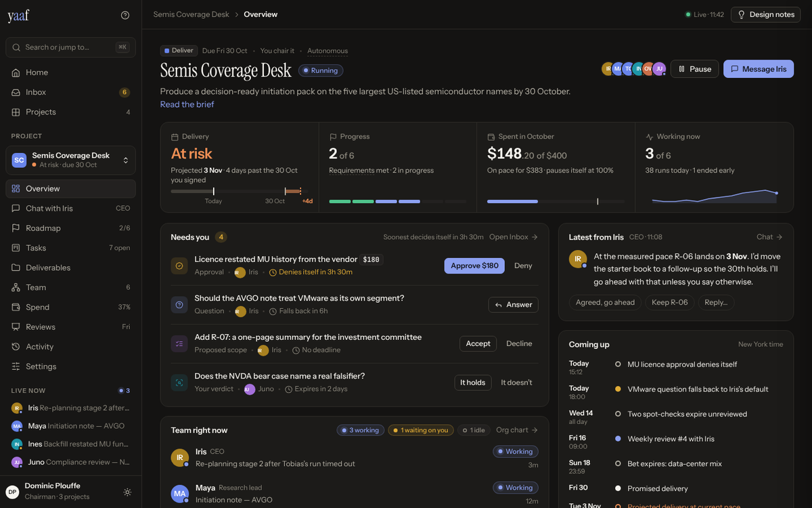
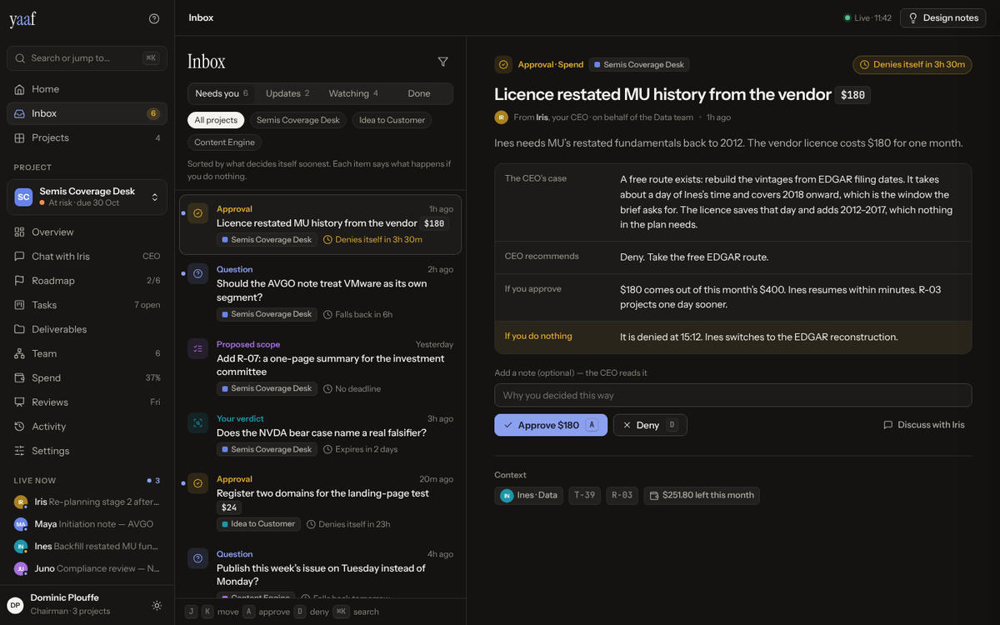
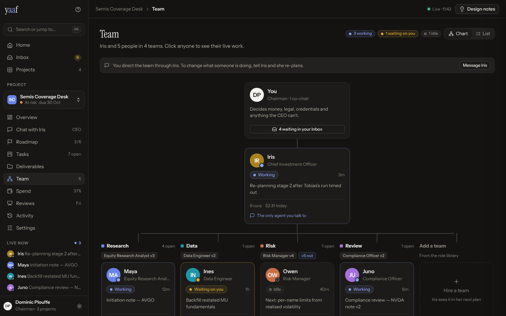

# UX redesign — research and proposal

**Open the mockup:** [`mockup.html`](mockup.html) (download and open it in a browser; it is one
self-contained file). Press **Design notes** in its top bar to see the reasoning pinned to each
screen, or open **Why this design** in its sidebar for the summary.

The ask: make yaaf feel like a normal SaaS product you can learn by browsing — technical users,
no doctorate in yaaf required — with the Overview as the priority. A competitor, Paperclip, was
named as the benchmark for being intuitive, especially its Inbox and org chart.

This proposal changes **structure and words**, not the product. Every house rule in
`CONTRIBUTING.md` holds, the domain model is untouched, and the mockup is built on the exact
design tokens in `web/src/styles.css`.

| Overview | Inbox | Team |
|---|---|---|
|  |  |  |

---

## 1. What was studied

**yaaf, today.** A screen-by-screen read of `web/src` (routes, every tab, every label), the docs,
and the screenshots. Note that `docs/DASHBOARD.md` and `docs/screenshots/` describe the older
six-tab layout; the code now has Overview / Boardroom / Progress / Deliverables + Records.

**Paperclip.** Its open-source repository (`github.com/paperclipai/paperclip`, MIT) — the React
UI source, `DESIGN.md`, `doc/PRODUCT.md`, its in-repo design guide and the screenshots it ships —
plus published reviews. Its marketing site could not be fetched from the research environment,
so everything below comes from the product's own source and docs, which is the more reliable
record anyway.

## 2. Why yaaf feels hard today

The product's ideas are sound. The interface makes you assemble them yourself.

1. **Attention is scattered.** At least **14 places** show something that needs you, using
   **3 different definitions**. The header's "Waiting on you" counts approvals, asks, scope and
   the date; the Overview's "Needs a decision" lists only approvals and expired bets; asks can
   only be read under Records → Decisions; the Desk says "Answer in the boardroom" but the
   Boardroom doesn't show asks. A header can read 3 while the list under it shows 1.
2. **The Overview is a 12-section scroll** (verdict, needs-decision, CEO flags, deliverables,
   mode strip, is-it-working, calendar, watch, plan, money, health, roster) fed by ~16 pollers,
   each section with its own visual grammar.
3. **Agents aren't people on screen.** There is no org chart ("See the org chart" scrolls to a
   card grid) and no per-agent "doing now" line — that takes a trip to Records → Runs.
4. **Synonyms everywhere.** Task / job / run / "piece of work". Requirement / scope / "what has
   to be true". Evidence / proof / claim. "Desk" is both the inbox page and a team. "Brief" is the
   goal, the "why is nothing happening" banner *and* the morning email.
5. **Meaning lives in paragraphs, not layout.** ~24 help blocks on the Overview alone, 55 in
   project Settings, 125 "→" text links. Governance jargon (drought, plan gate, pacing, curator,
   pair breaker, attested) sits on the main path.
6. **Hidden navigation.** No project switcher; Settings behind a gear; Progress hides three
   lenses and Review behind a segmented control; Records hides five views behind pills.

## 3. What Paperclip gets right (and what to take)

Paperclip's own design rule: *every screen answers what is happening, does it need me, what do I
do about it.* Its pitch: "it looks like a task manager; underneath, org charts, budgets and
governance." The transferable patterns:

| Pattern | In Paperclip | In the mockup |
|---|---|---|
| Familiar SaaS nouns first | Dashboard, Inbox, Tasks, Projects, Agents, Settings | Home, Inbox, Overview, Roadmap, Tasks, Team, Spend, Activity |
| One triage inbox | Approvals, failed runs, tasks, alerts; inline verbs; j/k; "Inbox zero" | Inbox with *Needs you / Updates / Watching / Done* |
| Ambient liveness | Running agents listed in the sidebar with pulsing dots | "Live now" sidebar section; status dots on every face |
| KPI tiles that link | 4 tiles, one question each, one-line breakdown | Delivery · Progress · Spend · Working now |
| Org chart as a view of people | List / Org toggle on Agents | Team page: Chart / List toggle |
| Decisions as cards in the conversation | Pending-interaction cards above the composer | Approval and flag cards inside Chat with Iris |
| ⌘K + `?` cheatsheet | Pages, actions, entities, operators | Same, plus `g i` / `g o` / `g t` jumps |
| Progressive disclosure of runs | Summary → "worked 5m · 3 tools" → raw | Agent drawer: steps, then raw log |

**Where yaaf should beat it** — and the mockup leans on these:

- **A ranked "Needs you", not a count.** Paperclip's dashboard shows pending approvals as one tile
  among four. yaaf's existing rule — every row says what happens if you do nothing, ranked by time
  to consequence — is better and now leads the Overview and the Inbox.
- **Org-chart nodes that show work.** Paperclip's nodes are identity only. Ours show status,
  current task, time on it, runs and spend.
- **A delivery promise.** Paperclip has no project-level date. Promised vs projected is the first
  tile on the Overview.
- **Stable vocabulary.** Paperclip churns (task/issue, company/organization, two UI shells,
  ~30 feature flags). Pick one word per concept and keep it.

## 4. Principles

1. Every screen answers, in order: **what is happening, does it need me, what do I do about it.**
2. **One count for "needs you", everywhere.** Sidebar badge, Overview card and Inbox read one list.
3. **Plain words in the interface; yaaf's words one hover away** (dotted-underline terms).
4. **Agents are people with a current task** — a face, a name, a status dot, a "doing now" line.
5. **Layout carries meaning, not paragraphs.** Status is a pill, urgency is a clock, the
   consequence of silence is one labelled line.
6. **House rules stay visible, not explained.** A read-only screen offers the real way forward
   ("Ask Iris") where the missing button would be.

## 5. Information architecture

```
Home                      cross-project: greeting, needs-you, project health, daily brief, getting started
Inbox (badge)             Needs you · Updates · Watching · Done — all projects, filterable
Projects                  table of every project

[Project switcher]        name · health · due date
  Overview                the cockpit (below)
  Chat with Iris          the boardroom, renamed for the person in it
  Roadmap                 requirements by stage, burn-up, the delivery banner and its levers
  Tasks                   board / list, read-only, tied to requirements
  Deliverables            files by day with an in-place reader
  Team                    org chart / list; agent drawer
  Spend                   budget policy, per-day, by team / person / model
  Reviews                 the standing meeting, past and next
  Activity                one timeline replacing Records' five pills
  Settings                grouped by question: who decides, how often, how good

Live now                  agents currently working, one click to their live run
Workspace                 Role library · Settings
```

### Overview — three questions, five seconds

1. **Header:** shape, due date, autonomy level, name + status, the one-line goal, team avatars,
   **Pause** and **Message Iris**.
2. **Four linked tiles:** *Delivery* (at risk · projected 3 Nov vs promised 30 Oct, with a
   timeline showing the slip), *Progress* (2 of 6 requirements), *Spent* ($148 of $400, on pace,
   warn mark), *Working now* (3 of 6, runs today, a sparkline).
3. **Needs you** — the Inbox filtered to this project, inline Approve/Deny/Answer, each with its
   clock ("Denies itself in 3h 30m").
4. **Team right now** — every seat: status pill, the task it is on, time on it. Click → drawer.
5. **Latest from Iris** — the CEO's last word with quick replies.
6. **Coming up** — the agenda in plain words, coloured by who resolves it (you / itself /
   meeting / deadline / projection).
7. **Roadmap**, **where the money went**, **latest deliverables**.
8. **Health** collapsed to one line when healthy.

What leaves the Overview: the separate "Your CEO is telling you" and "Watch" lists (now Inbox →
Updates and Watching), the plan sentence (now the Progress tile + Roadmap card), the long
explanatory copy.

### Inbox

- **Needs you** (the badge): approvals, questions, proposed scope, verdicts, dates to sign,
  expired bets, frozen threads — exactly the Desk's definition, so the Desk's rule ("every row is
  something only you can do") survives intact. Sorted by time to consequence.
- **Updates** (no badge): CEO flags (answer with *Noted*), published deliverables, the daily
  brief, runs that ended early, upcoming reviews.
- **Watching** (no badge): budget pace, bet deadlines, gaps in outside proof, memory pressure —
  today's Overview → Watch.
- **Done**: what you decided, with your note.

Each item reads the same way: what is asked → the CEO's case → what each choice does → **what
silence does** (highlighted) → the action with an optional note the CEO reads. Keyboard: `j`/`k`,
`a` approve, `d` deny.

### Team

You → Iris (CEO) → each team (role and version, open tasks, "v5 out" when a newer role exists) →
its people. Every node shows status, current task, time on it, runs and spend today. A banner
states the chain of command once: *you direct the team through Iris.* The agent drawer has
**Now** (current task + live run steps), **Work**, **Runs**, **About**, and its primary button is
**Ask Iris about Maya** — never a direct message.

## 6. Vocabulary

| Today | Proposed | Why |
|---|---|---|
| Desk / "Your desk" | **Inbox** | The word every SaaS user knows |
| Boardroom | **Chat with Iris** | Name the person, not the room |
| Progress → The plan | **Roadmap** | Requirements keep their name inside it |
| Progress → Who is doing it | **Tasks** | A board, read-only |
| Progress → What proves it / Records → Evidence | **Activity → Proof & files** | Evidence lives in one place |
| Review (behind a banner) | **Reviews** | A page of its own |
| Records (Runs, Messages, Memory, Decisions, Evidence) | **Activity** | One timeline with filters |
| "Who is on this" cards | **Team** | Hierarchy + live work |
| People you can hire | **Role library** | Matches the page title |
| Rules in force / constitution | **Settings → How it runs** | Questions first, every rule one click away |
| Drought | "No outside proof for 14h" | Say what it means |
| Task / job / run / piece of work | **Task** (work) and **Run** (one attempt) | Two words, never four |

## 7. What does not change

- The chairman speaks only to the CEO. The org chart never offers a direct message.
- Only the CEO creates tasks; only the platform marks a requirement met. Tasks is read-only.
- Silence is a decision: approvals deny themselves, questions fall back to the CEO's default, and
  every Inbox item says so.
- Every change to money, dates, scope or rules asks for a reason the CEO reads.
- Spend, legal, tool-request and assist approvals stay undelegable at every autonomy setting.
- The design tokens, including the contrast-checked status colours and the fixed team slots.

## 8. Suggested order of work

1. **Inbox + one needs-you definition.** The biggest trust win. Mostly a unification of
   `/observe/desk`, `/approvals`, `/asks` and `/flags`; the badge, header vital and Overview card
   then read the same list.
2. **Sidebar IA, project switcher, ⌘K.** The pages exist; this is navigation and naming.
3. **Team page and agent drawer.** Needs a per-agent "current task" in the org payload — the
   board's holder and the latest run already carry it.
4. **The new Overview.** Fewer sections; consider one aggregated
   `/observe/projects/:id/overview` instead of ~16 pollers.
5. **Activity** replacing the Records pills; then Roadmap, Tasks, Spend, Reviews, Settings.

Per `CLAUDE.md`, the Inbox is a new concept whose nearest sibling is the Desk: diff its footprint
(daily brief, agenda, change stamp, MCP reader, CLI, `docs/DASHBOARD.md`) before calling it done.

## 9. Open questions

- **Rename the Boardroom?** "Chat with Iris" is clearer on first use; "Boardroom" carries the
  governance framing and the Slack channel name. The mockup keeps the Slack name.
- **Updates in the Inbox.** `docs/DASHBOARD.md` deliberately keeps "what happened" off the Desk.
  The mockup puts it in a separate, unbadged tab so the badge stays honest — worth confirming that
  this keeps the spirit of that rule.
- **Mobile.** The mockup is responsive, but a bottom nav (Home · Inbox · Chat · Team), as
  Paperclip ships, would suit approve-from-your-phone better.
