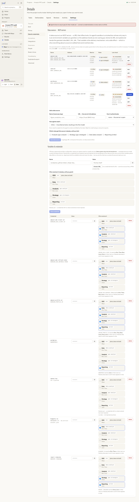
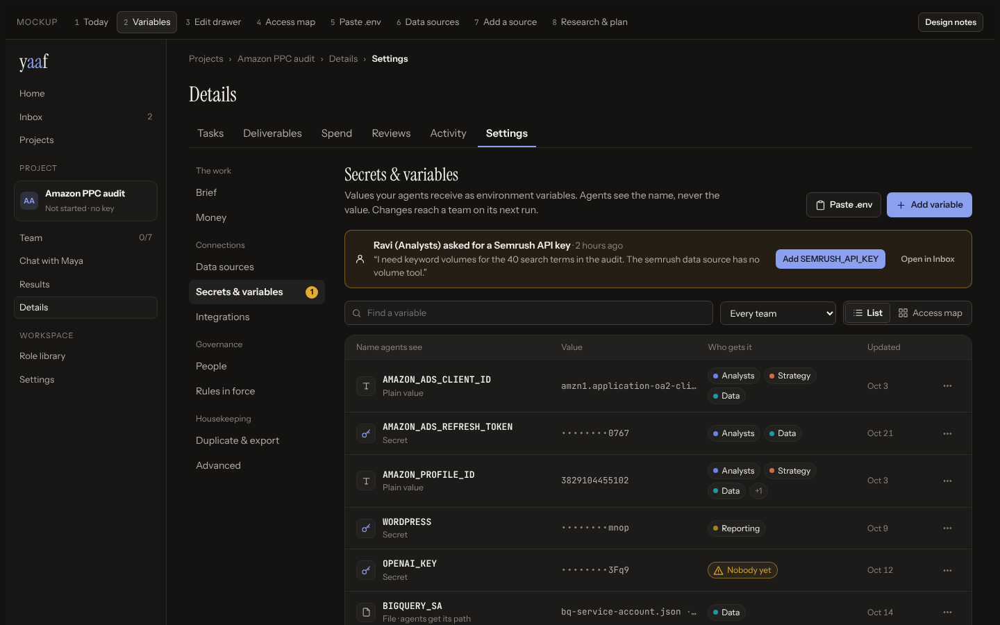
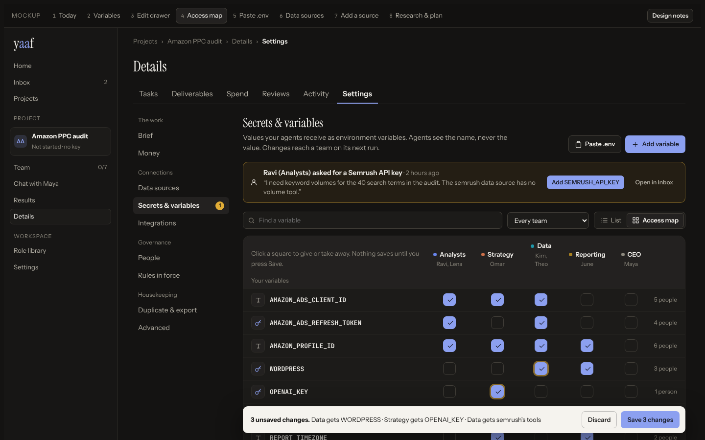
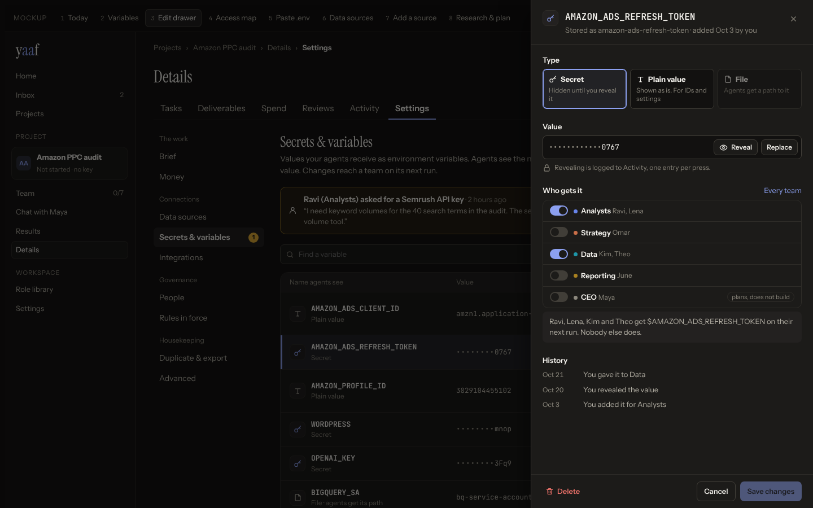
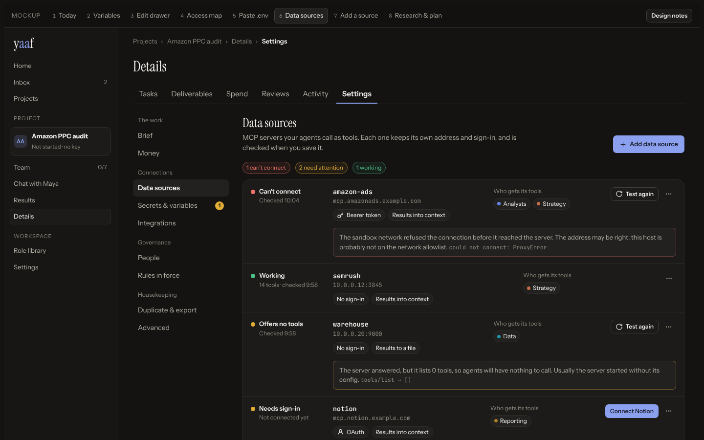

# Data & credentials — research and mockups

**Open the mockup:** [`mockup.html`](mockup.html) (one self-contained file; download and open it
in a browser). The bar at the top switches between eight screens: **Today** (the audit),
**Variables**, **Edit drawer**, **Access map**, **Paste .env**, **Data sources**, **Add a source**
and **Research & plan**. **Design notes** pins the reasoning to each part.

> **Status: proposal.** Nothing in `web/src` or the server has changed. This folder is for
> deciding whether to build it.

| Today (full length) | Variables | Access map |
|---|---|---|
|  |  |  |

| Edit drawer | Data sources |
|---|---|
|  |  |

## What is wrong today

Measured on a project with five teams, seven credentials and four data sources, at 1440px:

- **5,171px tall.** Every credential row draws all five teams as cards (`RoleGrants`), about 410px
  per row. The row height grows with the number of teams.
- **The inventory is below two forms.** Each section opens with an always-visible add form, 13
  fields in all. The first stored credential is about 1,300px down.
- **You can't see what one team gets.** Grants are spread across 35 cards and a second table.
- **Three save models on one page.** A grant checkbox saves the moment you click it. A revealed
  value saves with its own button. A data source has Save changes.
- **Every value is `••••••••••••`.** A timezone, an ad account ID and a refresh token look the
  same, and two keys can't be told apart without revealing both.
- **One team, three looks.** A card, a `Data (data-analyst)` checkbox and a `data-analyst` pill.
- **Health that doesn't help.** All four sources read "unreachable"; Notion shows "not connected"
  and "unreachable" together; the explanation is `could not connect: ProxyError`.
- **Values hidden without a trace.** Data-source URLs and tokens are filtered out of the list
  (rightly), but nothing on screen says so.

## The proposal

1. **Two pages under Connections:** *Data sources* and *Secrets & variables*, next to
   Integrations. Each has one list, one sentence of explanation and one primary button.
2. **One row per variable, about 56px.** It shows the name agents see (`$NAME`), the type (secret,
   plain value or file), the last four characters of a secret or the plain value itself, who gets
   it as team chips (people on hover), and when it was updated. Edit and delete go in a ⋯ menu.
3. **Every edit happens in a drawer,** with one Save button that is disabled until something
   changes. Delete confirms inline and names who loses access.
4. **An access map:** variables and data sources as rows, teams as columns. Changes stage with a
   ring and save as one batch. A filter, "What Data gets", answers the question from the list too.
5. **Paste .env:** pasted lines split into rows, each with a guessed type you can change, and
   any name that already exists is flagged.
6. **Values set up by a data source are listed, locked,** and link to the source that owns them.
7. **Data source health in words,** one state each: *Can't connect*, *Needs sign-in*,
   *Offers no tools*, *Working*. Each state has the button that fixes it, and the raw error is
   kept in small text.
8. **Add a source by address first.** The check that runs on save today runs first, to detect
   how the server signs in. Everything else follows from it.
9. **Agents' credential requests** (`tool_request` approvals) appear on the page, with a
   one-click fill that switches on the requesting team.

## What it keeps and what it costs

The house rules hold. The chairman can still reveal a value, and each reveal is logged once.
Nothing is granted until a team is switched on. Agents get names, never values. A data source
still saves in one validated motion. "Every team" switches on the teams that exist today and
never auto-grants future hires.

The list, drawer, map, `.env` paste, request callout and one shared team picker are web-only and
use today's endpoints. The plain-value type, last-four hint, updated date and finer health states
need small server changes and one migration. *Research & plan* in the mockup has the table, along
with what comparable products do (Vercel, GitHub, Doppler, Infisical, Railway, Fly.io,
Cloudflare, Heroku, Zapier, Make, Claude.ai connectors) and what was deliberately not copied.
