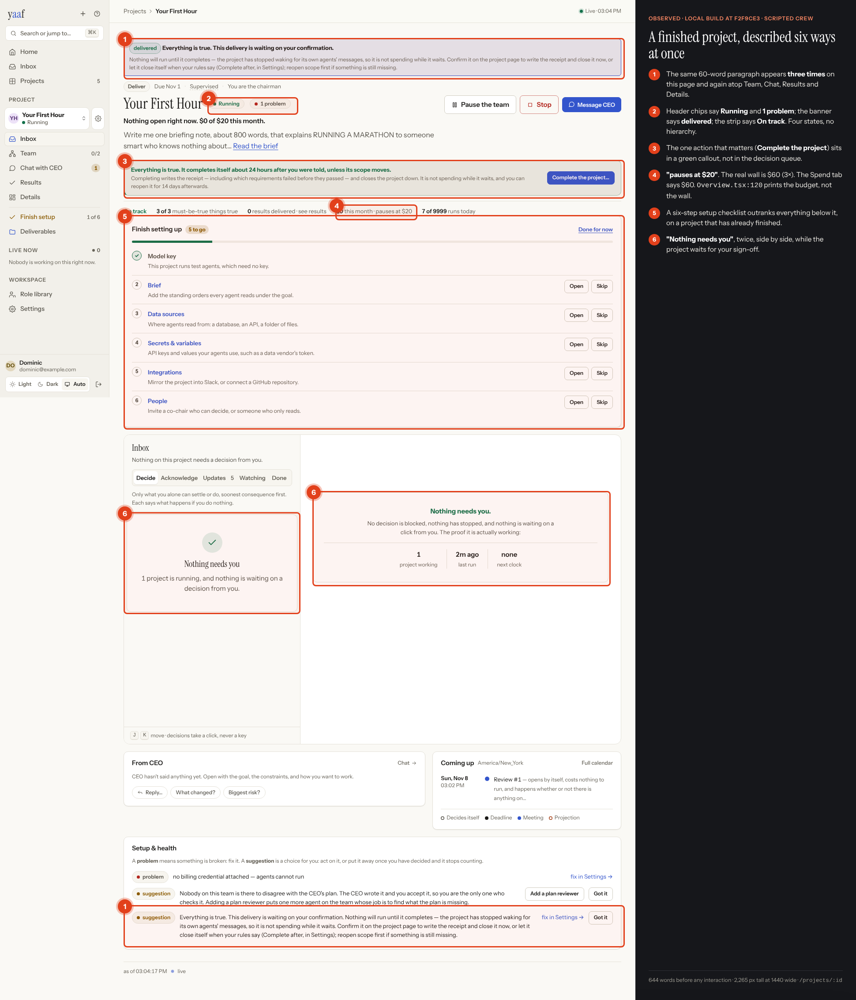
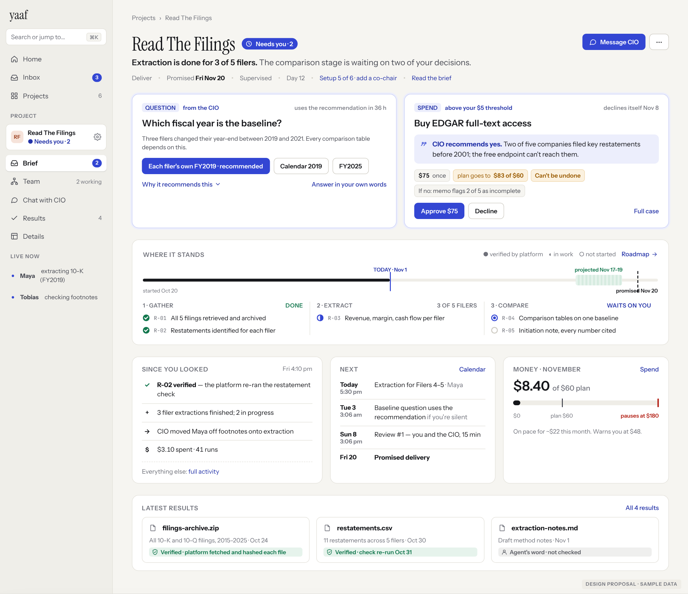
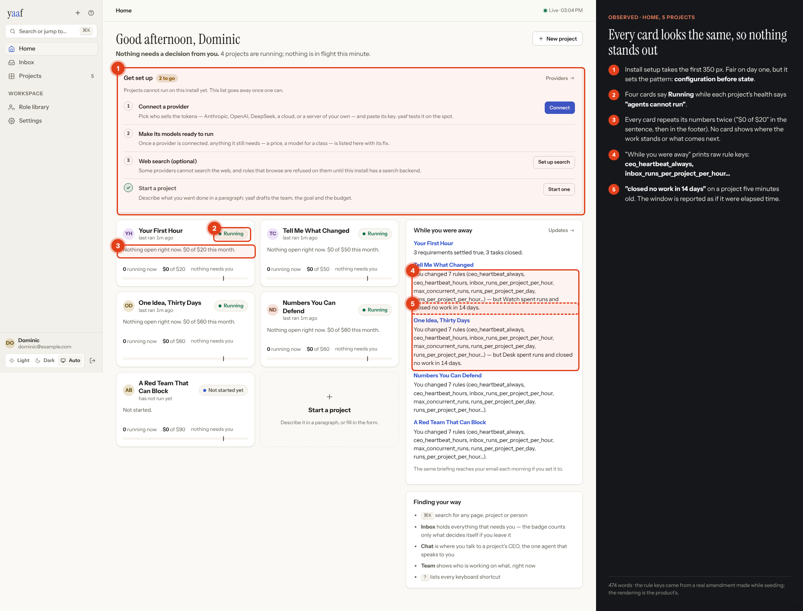
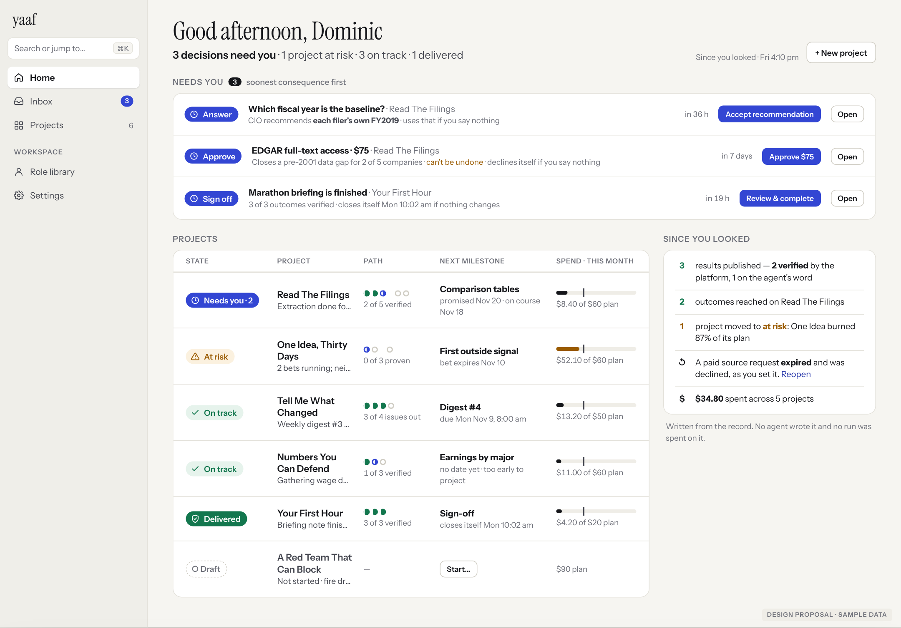

# YAAF Signal: product experience transformation

**Read the report:** [`report.html`](report.html). Download it with the `after/` and `before/` folders and open it in a browser, or view the published copy linked in the PR.

| Today (annotated, observed) | Proposed |
|---|---|
|  |  |
|  |  |

> **Status: built.** Everything below is in the app, and `built/` holds screenshots of the
> real thing, taken from the demo `tests/e2e/demo.py` builds — eight projects with weeks of
> history, priced runs, published files, one late and one failing: [Home](built/home.png) ·
> [a project with decisions](built/project-decisions.png) · [a finished project](built/project-finished.png) ·
> [a spend decision](built/inbox-spend.png) · [scope, accepted in place](built/inbox-scope.png) ·
> [Roadmap](built/roadmap.png) · [Results](built/results.png) · [Activity](built/activity.png) ·
> [Projects](built/projects.png) · [phone](built/phone-project.png) · [dark](built/project-dark.png).
> Where the build differs from the mockups: the project page keeps the name **Inbox** (the
> proposed rename to "Brief" would collide with the goal, which is already called the brief);
> approvals carry the CEO's recommendation as a field the CEO must fill (the agent API refuses
> one without it), so the card never guesses it from the case; the project page draws its
> decisions as the same cards the Inbox opens, from the one list; and email links open the
> signed-in Inbox row — they never decide anything by being opened. Approve, answer, accept
> scope, complete and start are covered by browser tests on that demo (`web/e2e`, run in CI).

**In one line:** YAAF already knows almost everything a chairman needs. The interface shows it in several competing forms. The proposal adds **one state per project** (a server-derived ladder), **one decision card** for every kind, **the path to the promise drawn honestly**, and **a trust seal on every result**. Navigation is kept, and no capability is removed.

**Overall today: 5.0 / 10.** Navigation 7.5 · decision cards 7.0 · trust model 6.5 · interaction 6.0 · visual polish 5.5 · coherence 4.5 · clarity of state 3.5 · economy of words 3.0.

## Fix first (P0)

1. **`web/src/pages/project/Overview.tsx:120` prints the budget as the stop.** It says "pauses at $20" when the wall is $60. It also says "the cap is reached — the project is paused" at 100%, which is false.
2. **Completion sign-off isn't a decision.** Web, `yaaf status` and `yaaf briefing` all say nothing is waiting, while the project closes itself in 24 h.
3. **One derived state + sentence.** One project header showed Running, delivered, 1 problem, On track and "Nothing needs you" at once. Separately, `yaaf status` (2 waiting) and `yaaf briefing` (1 waiting) disagree for the same project.
4. **Delete repeats.** A 63-word notice appears 3× on one page and at the top of 5 pages.

## Contents

| File | What |
|---|---|
| `report.html` | The report: verdict, north star, audit, design language, concepts, before → after, priorities, feature map, roadmap, validation, 12 scenarios |
| `mockups.html` → `after/*.png` | High-fidelity concepts: Home, Brief, decisions, Roadmap, Results, recovery, phone, design system, CLI/MCP/email |
| `before.html` → `before/*.png` | Real screenshots with numbered findings. Raw captures are in `before/raw/` |
| `seed/render.js` | Renders the mockup PNGs from `mockups.html` and `before.html` |

## How the evidence was produced

The live instance couldn't be reached from the research environment (network policy), so the product was run locally at `f2f9ce3`: SQLite, dev mode, no Docker.

```bash
python3 -m venv .venv && .venv/bin/pip install -e ".[dev]" && (cd web && npm install && npm run build)
.venv/bin/python tests/e2e/demo.py /tmp/yaaf-demo --serve=8080   # seeds, then serves it on :8080
# sign in as dominic@example.com / demo-password-123
```

Agents are the repo's own scripted rehearsal crew (`yaaf/rehearsal/crew.py`). The audit's
evidence came from a smaller seed (six projects, costs zero, time compressed, nothing
published), so the findings that may come from the harness are marked in the report. That
seed was replaced by `tests/e2e/demo.py`, which ages each project over weeks, prices every
run, publishes files and breaks two projects the way real ones break. Mockup content is sample data in the shape of real payloads and is labelled on every image. **No product code was changed.**

## Relationship to earlier studies

- [`../README.md`](../README.md): the IA redesign. Shipped, and navigation is now the strongest part. Kept.
- [`../product-experience-audit/`](../product-experience-audit/README.md): the 23 Oct audit (4.5/10). Since then the Spend page states the 3× wall truthfully and the project collapsed to 5 pages. Its money finding survives in the header strip, and "one status" is still open. This study adds the visual system, the state ladder, rendered concepts and annotated evidence.
