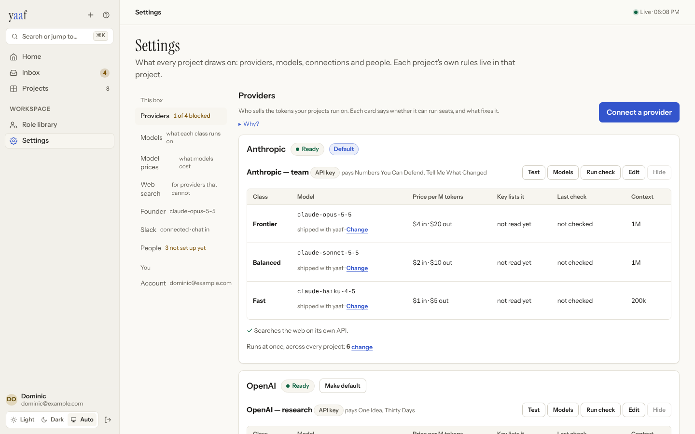
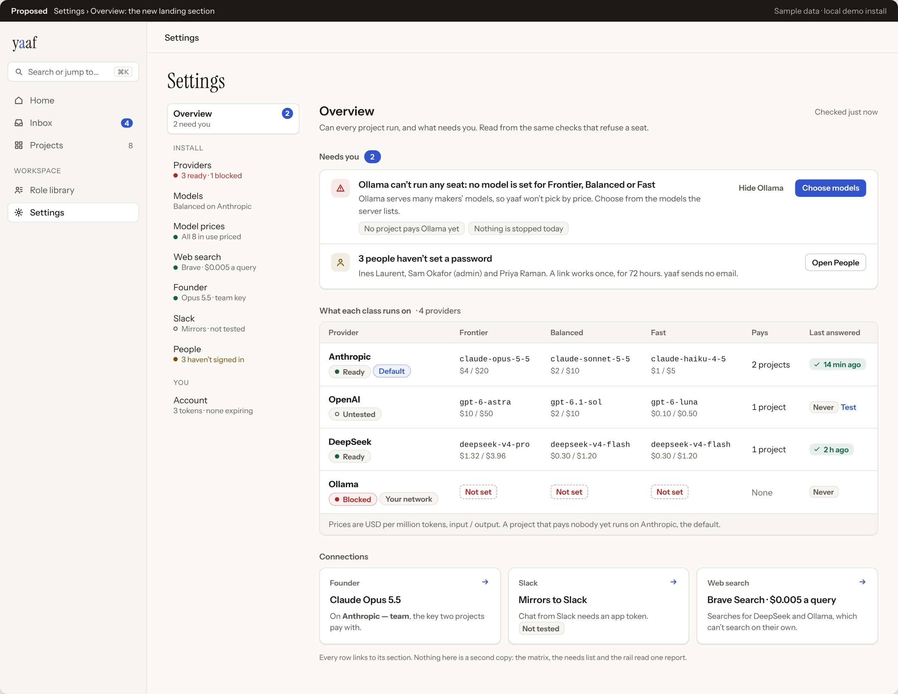
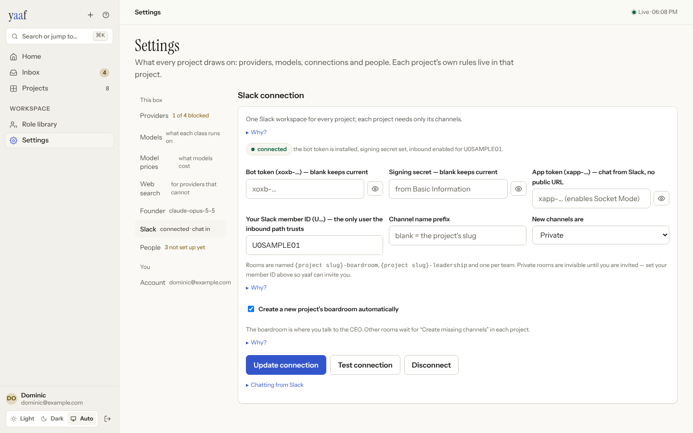
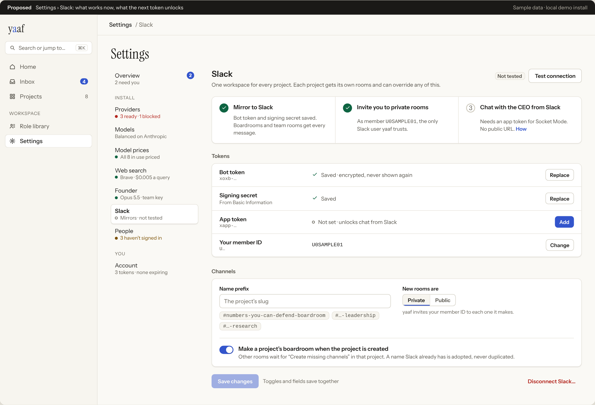

# Settings: a design study

**Read the report:** [`report.html`](report.html). Download it with the `before/` and `after/`
folders and open it in a browser, or view the [published copy](https://claude.ai/artifact/EgBCuMUnSyS7PKT9Xzbe7n). Concepts are in
[`mockups.html`](mockups.html); the PNGs in `after/` are rendered from it.

> **Status: built.** All three phases of the roadmap are in the app, and `built/` holds screenshots
> of the real thing on the demo seed plus `seed/configure.py`: [Overview](built/overview.png) ·
> [Providers](built/providers.png) · [a class changed in place](built/lineup-preview.png) ·
> [a priced menu](built/key-menu.png) · [All keys](built/all-keys.png) · [Models](built/models.png) ·
> [Model prices](built/prices.png) · [Web search](built/search.png) · [Founder](built/founder.png) ·
> [Slack](built/slack.png) · [People](built/people.png) · [phone index](built/phone-index.png) ·
> [phone Slack](built/phone-slack.png) · [dark](built/overview-dark.png).
>
> The sample keys are fake, and that is what the screenshots show: Anthropic answered its key with
> a real `401`, so it is **Failing**, and the Overview leads with it and with the Founder that borrows
> it. The two keys nothing has called are **Untested**. Nothing on the page is green.
>
> | Measured at 1440px, same seed | Before | Built | Target |
> |---|---|---|---|
> | Words on screen, 8 sections | 2,344 | 1,405 | ≤ 1,600 |
> | Providers page, 4 providers | 2,475px | 1,096px | ≤ 1,100px |
> | Providers page on a phone | 4,808px | 1,972px | ≤ 2,000px |
> | Buttons on Providers | 65 | 23 | — |
> | Browser `confirm()` dialogs | 6 | 0 | 0 |
> | Sideways scroll at 390px | Slack form unusable | none, every section | none |
>
> Slack carries more words on screen than before (137 → 197) and Account slightly more (a header):
> the ladder shows what used to be folded under four "Why?"s.
>
> **Server.** `yaaf/core/key_evidence.py` reads whether a key has answered (a Test, its model list,
> a graded check, a run of a project it pays) or been refused, counting only what happened since
> its value last changed; the readiness report gains `status` and `evidence`, leaving `ready` as
> it was for every screen that reads it. `yaaf doctor` gains **keys answer**. Slack, web search and
> the Founder remember their last test and forget it when changed. `DELETE /web-search?dry_run=true`
> and `POST /models/lineup/preview` answer what a removal or a lineup change would do, from a
> savepoint the change is made in and rolled back. `GET /admin/users` says when an invite link runs
> out. Tests: `tests/selftest_invariants/test_key_evidence.py`; browser: `web/e2e/settings.spec.ts`.
>
> **Where the build departs from the mockups.** The Overview's "Not confirmed yet" list is its own
> group, so untested keys never inflate the count of what needs you. Provider rows put the facts on
> one line under the models instead of four columns. In Prices, *Use shipped* and *Remove* live in
> the row's edit state rather than a ⋯ menu, so the table fits at 1440px. A switch inside a form
> (Slack's boardroom switch) is a field of that form; only a switch on its own (upkeep) is held
> with Undo. The Slack room-name preview says `{project slug}` rather than guessing a real one.

| Today (observed, local build) | Proposed |
|---|---|
|  |  |
|  |  |

**In one line:** the parts underneath app-wide Settings are well made: readiness with one-press
fixes, a connect flow that tests the key, a paid check that prices itself, an import that
previews. The page around them answers "what is configured" when the admin is asking "can every
project run, and what needs me". This proposal keeps every capability and changes how it is
shown: an **Overview** that lands first, **green that means a key has answered**, problems open
and healthy providers folded to a row, and **one kit** (header, status, evidence, secret field,
actions, saving) that all eight sections are built from.

**Overall today: 4.4 / 10.** Navigation 6.2 · visual polish 5.2 · interaction 4.8 · coherence 3.8 ·
clarity of state 3.5 · communication 3.0.

## Fix first (P0)

1. **"Ready" is green for keys nobody has seen work.** `yaaf/core/readiness.py` derives it from
   lineup, price and search alone; three sample keys that could never answer all showed Ready.
   Slack's "connected" means a token was saved. Add **Untested** and **Failing**, and show the last
   answer beside the badge (runs already record `provider`, `status` and `error_kind`).
2. **The one problem is fourth.** Provider cards keep their order whatever their health; the
   blocked one starts 1,785px down the landing page. Sort by health and put the issues on top.
3. **Consequences after the press.** Six browser `confirm()` dialogs; removing web search lists the
   seats it stranded only after it has removed it. Confirm in the page, from a dry run.
4. **Rail and layout bugs.** `styles.css:3325` puts each rail note beside its label (so two labels
   wrap); 3 of 8 notes describe the section instead of reporting its state; the Slack form does not
   stack at 390px; the full key table clips its Actions column at 1440px; model ids wrap mid-name.

## Contents

| Path | What |
|---|---|
| `report.html` | Verdict and scores, north star, annotated audit of all 8 sections, concepts, before → after, the Settings kit, ranked improvements, feature preservation map, roadmap with acceptance criteria, validation plan, scenarios |
| `mockups.html` → `after/*.png` | Overview, Providers, a provider opened, Models, Model prices, Founder, Slack, People, phone, the kit, Overview in dark |
| `before/*.png` | Real captures from the local build: every section at 1440px, first run, connect flow, check dialog, the second key list, phone |
| `seed/configure.py` | Gives the demo install the Settings a real install has, through the admin API |
| `seed/capture.js` | Captures every section and counts words, controls and folds |
| `seed/render.js` | Renders `after/*.png` from `mockups.html` |

## How the evidence was produced

The live instance could not be reached from the research environment (network policy), so the
product was run locally at `42d1545`, the same code. Nothing was observed on the live site, and
its test account was not used.

```bash
python3 -m venv .venv && .venv/bin/pip install -e ".[dev]" && (cd web && npm install && npm run build)
.venv/bin/python tests/e2e/demo.py /tmp/yaaf-demo --serve=8765      # seeds 8 projects, then serves
.venv/bin/python docs/ux-redesign/settings/seed/configure.py        # providers, Slack, search, people
node docs/ux-redesign/settings/seed/capture.js /tmp/settings-shots 1440 light
node docs/ux-redesign/settings/seed/render.js                       # after/*.png from mockups.html
```

Every key `configure.py` stores is a labelled sample that no provider would accept. That is how
the Ready finding surfaced. Mockup content is sample data in the shape of the real payloads;
timestamps like "answered 14 min ago" are illustrative, and the report names the data each one
needs. **No product code was changed.**

## Relationship to earlier studies

- [`../experience-transformation/`](../experience-transformation/README.md) shipped the Signal
  vocabulary: badges with words, the filled "yours to press" chip, trust seals, fact chips. This
  study uses it unchanged and adds two states (Untested, Failing). Settings was the one surface
  that study left alone.
- [`../README.md`](../README.md) kept Settings' sections and deferred a rename. This study keeps
  the section names and the URLs (`?section=`, `?provider=`, `?connect=`, `?show=`, `?model=`), and
  adds one section, Overview, in front.
- [`../data-and-credentials/`](../data-and-credentials/README.md) redesigned a *project's*
  credentials page. This one is the install's, and the two should share the secret-field and
  evidence patterns in `after/system.png`.
